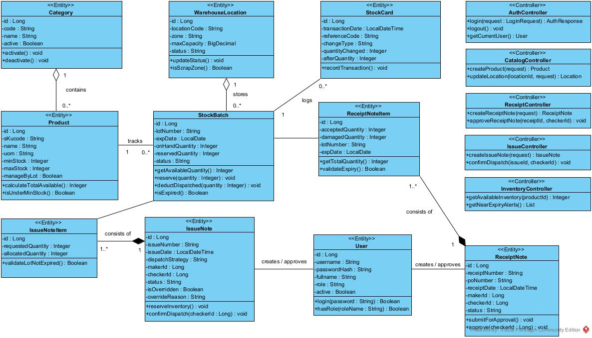
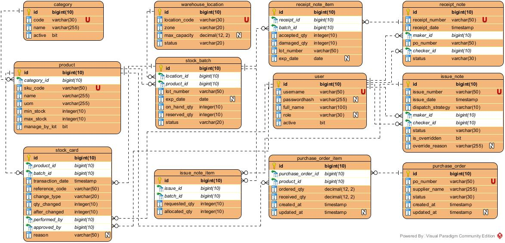

# BÁO CÁO THIẾT KẾ CLASS DIAGRAM & ERD PHÂN TÍCH NGHIỆP VỤ

> **Nhiệm vụ:** `T2.3` (Sprint 2) | **Maker:** M1 - Nguyễn Thành Trung | **Reviewer:** M2 - Nguyễn Bảo Khang  
> **Phạm vi:** 4 Phân hệ Must-have (`FR01` – `FR04`) & Xác thực người dùng (`Auth`)

---

## 1. BIỂU ĐỒ LỚP PHÂN TÍCH (CLASS DIAGRAM)

### 1.1. Danh mục 11 Lớp Thực thể (`<<Entity>>`)

| Lớp Thực thể | Ý nghĩa nghiệp vụ | Thuộc tính chính | Phương thức nghiệp vụ |
| :--- | :--- | :--- | :--- |
| **`Category`** | Ngành hàng phân loại | `code` (Unique), `name`, `active` | `activate()`, `deactivate()` |
| **`Product`** | Mặt hàng lưu kho (SKU) | `skuCode` (Unique - BR-CAT-01), `uom`, `minStock`, `maxStock`, `manageByLot` | `calculateTotalAvailable()`, `isUnderMinStock()` |
| **`PurchaseOrder`** | Đơn mua hàng tham chiếu (PO Header) | `poNumber` (Unique - BR-INB-01), `supplierName`, `status` | `isDeliverable()`, `closePO()` |
| **`PurchaseOrderItem`** | Chi tiết đơn mua hàng (PO Detail) | `orderedQty`, `receivedQty` | `getRemainingQty()`, `updateReceivedQty()` |
| **`WarehouseLocation`** | Vị trí ô kệ chuẩn 3M | `locationCode` (Unique - BR-CAT-02), `zone`, `maxCapacity`, `status` | `updateStatus()`, `isScrapZone()` |
| **`StockBatch`** | Lô hàng tồn kho (Trung tâm) | `lotNumber`, `expDate`, `onHandQuantity`, `reservedQuantity`, `status` | `getAvailableQuantity()`, `reserve()`, `deductDispatched()`, `isExpired()` |
| **`StockCard`** | Thẻ kho ghi biến động | `transactionDate`, `referenceCode`, `changeType`, `quantityChanged`, `afterQuantity` | `recordTransaction()` |
| **`ReceiptNote`** | Phiếu nhập kho (Header) | `receiptNumber` (Unique), `poNumber`, `receiptDate`, `makerId`, `checkerId`, `status` | `submitForApproval()`, `approve()` |
| **`ReceiptNoteItem`** | Chi tiết dòng nhập kho | `acceptedQuantity`, `damagedQuantity`, `lotNumber`, `expDate` | `getTotalQuantity()`, `validateExpiry()` |
| **`IssueNote`** | Phiếu xuất kho (Header) | `issueNumber` (Unique), `dispatchStrategy`, `makerId`, `checkerId`, `status`, `isOverridden`, `overrideReason` | `reserveInventory()`, `confirmDispatch()` |
| **`IssueNoteItem`** | Chi tiết phân bổ xuất kho | `requestedQuantity`, `allocatedQuantity` | `validateLotNotExpired()` |
| **`User`** | Tài khoản & Maker-Checker | `username` (Unique), `passwordHash`, `fullName`, `role`, `active` | `login()`, `hasRole()` |

### 1.2. Danh mục 6 Lớp Điều khiển Tiền khai báo (`<<Controller>>`)
*Phục vụ kết nối trực tiếp với Sequence Diagram (T2.4) và Component Spring Boot (T3.3):*

| Controller | Phân hệ tương ứng | Chức năng chính |
| :--- | :---: | :--- |
| **`AuthController`** | Xác thực / Security | Đăng nhập (`login`), Đăng xuất (`logout`), Lấy thông tin user hiện tại (`getCurrentUser`). |
| **`CatalogController`** | Phân hệ 1 (FR01) | Quản lý mặt hàng (`createProduct`) và vị trí ô kệ (`updateLocation`). |
| **`PurchaseOrderController`** | Phân hệ 2 (FR02) | Tiếp nhận đơn PO (`importOrder`), Lấy danh sách PO (`getAllOrders`), Chi tiết đơn PO & tồn giao (`getOrderByNumber`). |
| **`ReceiptController`** | Phân hệ 2 (FR02) | Tạo phiếu nhập theo PO (`createReceiptNote`), Duyệt phiếu nhập (`approveReceiptNote`). |
| **`IssueController`** | Phân hệ 3 (FR03) | Tạo phiếu xuất giữ chỗ (`createIssueNote`), Xác nhận thực xuất (`confirmDispatch`). |
| **`InventoryController`** | Phân hệ 4 (FR04) | Tra cứu tồn kho khả dụng (`getAvailableInventory`), Cảnh báo cận hạn (`getNearExpiryAlerts`). |

### 1.3. Bảng Quan hệ Cốt lõi
- **Aggregation (`o--`):** `Category` $\rightarrow$ `Product` (`1`..`0..*`), `WarehouseLocation` $\rightarrow$ `StockBatch` (`1`..`0..*`), `Product` $\rightarrow$ `PurchaseOrderItem` (`1`..`0..*`).
- **Composition (`*--`):** `PurchaseOrder` $\rightarrow$ `PurchaseOrderItem` (`1`..`1..*`), `ReceiptNote` $\rightarrow$ `ReceiptNoteItem` (`1`..`1..*`), `IssueNote` $\rightarrow$ `IssueNoteItem` (`1`..`1..*`).
- **Association (`--`):** `Product` $\leftrightarrow$ `StockBatch` (tracks), `StockBatch` $\leftrightarrow$ `StockCard` (logs), `StockBatch` $\leftrightarrow$ `Items` (cập nhật tồn lô), `User` $\leftrightarrow$ `ReceiptNote`/`IssueNote` (`creates / approves` - Maker-Checker).
- **Dependency (`<..`):** `ReceiptNote` $\rightarrow$ `PurchaseOrder` (references via `poNumber`).

---

## 2. LƯỢC ĐỒ THỰC THỂ - LIÊN KẾT (ERD - CHUẨN 3NF)

### 2.1. Chuẩn hóa 3NF & Khử Quan hệ N-N
- **1NF & 2NF:** 100% bảng có Khóa chính đơn nhân tạo (`id bigint(10) PK AUTO_INCREMENT`), thuộc tính nguyên tử, không có thuộc tính đa trị.
- **3NF:** Không có phụ thuộc bắc cầu; **không lưu cột dư thừa tồn khả dụng** (tính toán thời gian thực: `available = on_hand_qty - reserved_qty`).
- **Khử quan hệ N-N:** Quan hệ Nhiều - Nhiều giữa `product` và `warehouse_location` được phân rã triệt để qua bảng trung gian **`stock_batch`**.
- **Phân tách thực thể nghiệp vụ & bảng kỹ thuật:** Mô hình dữ liệu tập trung trọn vẹn vào **12 thực thể nghiệp vụ cốt lõi**. Các bảng hạ tầng như `audit_event` (nhật ký API kỹ thuật) và `warehouse_mutex` (khóa kỹ thuật phân tán chống xung đột ghi) không đưa vào ERD nghiệp vụ.
- **Phân tách thực thể nghiệp vụ & bảng kỹ thuật:** Mô hình dữ liệu chuẩn hóa 3NF tập trung trọn vẹn vào **12 thực thể nghiệp vụ cốt lõi**. Các bảng hạ tầng như `audit_event` (nhật ký API kỹ thuật) và `warehouse_mutex` (khóa kỹ thuật phân tán chống xung đột ghi) được quản lý ở tầng hạ tầng (infrastructure concern), không đưa vào ERD nghiệp vụ kho để đảm bảo tính toàn vẹn tham chiếu 3NF.

### 2.2. Danh mục 12 Bảng Cơ sở Dữ liệu

| Tên Bảng | Khóa chính (PK) | Khóa ngoại (FK) | Ràng buộc chính |
| :--- | :--- | :--- | :--- |
| **`category`** | `id bigint(10)` | — | `code` UNIQUE, `active bit DEFAULT 1` |
| **`product`** | `id bigint(10)` | `category_id` $\rightarrow$ `category.id` | `sku_code` UNIQUE (BR-CAT-01), `min_stock >= 0`, `manage_by_lot bit` |
| **`purchase_order`** | `id bigint(10)` | — | `po_number` UNIQUE (BR-INB-01), `status IN ('APPROVED','PARTIALLY_RECEIVED','CLOSED','CANCELLED')` |
| **`purchase_order_item`** | `id bigint(10)` | `purchase_order_id`, `product_id` | `UNIQUE(purchase_order_id, product_id)`, `ordered_qty > 0`, `received_qty >= 0` |
| **`warehouse_location`** | `id bigint(10)` | — | `location_code` UNIQUE (BR-CAT-02), `zone` (DOCK, INSP, RAW, FG, SCRAP) |
| **`stock_batch`** | `id bigint(10)` | `product_id`, `location_id` | `lot_number`, `exp_date` (NULL nếu không quản lý hạn), `on_hand_qty >= 0`, `reserved_qty >= 0` |
| **`stock_card`** | `id bigint(10)` | `product_id`, `batch_id`, `performed_by`, `approved_by` | `qty_changed <> 0`, `change_type`, `transaction_date`, `after_changed >= 0` (BR-SEC-02) |
| **`receipt_note`** | `id bigint(10)` | `maker_id` $\rightarrow$ `user.id` | `receipt_number` UNIQUE, `po_number`, `checker_id != maker_id` (BR-SEC-03) |
| **`receipt_note_item`** | `id bigint(10)` | `receipt_id`, `batch_id` | `accepted_qty >= 0`, `damaged_qty >= 0`, `exp_date` (NULL nếu không quản lý hạn) |
| **`issue_note`** | `id bigint(10)` | `maker_id` $\rightarrow$ `user.id` | `issue_number` UNIQUE, `dispatch_strategy` (FEFO/FIFO), `checker_id != maker_id` |
| **`issue_note_item`** | `id bigint(10)` | `issue_id`, `batch_id` | `requested_qty > 0`, `allocated_qty >= 0` |
| **`user`** | `id bigint(10)` | — | `username` UNIQUE, `passwordhash` NOT NULL, `active bit DEFAULT 1` |

### 2.3. Danh mục 16 Mối quan hệ Chân quạ (Crow's Foot 1:N Non-Identifying)
1. `category` (1) $\rightarrow$ `product` (N) [`category_id`]
2. `purchase_order` (1) $\rightarrow$ `purchase_order_item` (N) [`purchase_order_id`]
3. `product` (1) $\rightarrow$ `purchase_order_item` (N) [`product_id`]
4. `product` (1) $\rightarrow$ `stock_batch` (N) [`product_id`]
5. `warehouse_location` (1) $\rightarrow$ `stock_batch` (N) [`location_id`]
6. `product` (1) $\rightarrow$ `stock_card` (N) [`product_id`]
7. `stock_batch` (1) $\rightarrow$ `stock_card` (N) [`batch_id`]
8. `purchase_order` (1) $\rightarrow$ `receipt_note` (N) [`po_number`]
9. `receipt_note` (1) $\rightarrow$ `receipt_note_item` (N) [`receipt_id`]
10. `stock_batch` (1) $\rightarrow$ `receipt_note_item` (N) [`batch_id`]
11. `issue_note` (1) $\rightarrow$ `issue_note_item` (N) [`issue_id`]
12. `stock_batch` (1) $\rightarrow$ `issue_note_item` (N) [`batch_id`]
13. `user` (1) $\rightarrow$ `receipt_note` (N) [`maker_id`]
14. `user` (1) $\rightarrow$ `issue_note` (N) [`maker_id`]
15. `user` (1) $\rightarrow$ `stock_card` (N) [`performed_by`]
16. `user` (1) $\rightarrow$ `stock_card` (N) [`approved_by`]

---

## 3. ĐỐI SOÁT QUY TẮC NGHIỆP VỤ (BUSINESS RULES TRACEABILITY)

| Quy tắc | Nội dung | Thể hiện trên Class & ERD |
| :--- | :--- | :--- |
| **BR-CAT-01** | SKU duy nhất | `Product.skuCode` / `product.sku_code` UNIQUE |
| **BR-CAT-02** | Mã vị trí 3M | `WarehouseLocation.locationCode` / `warehouse_location.zone` (DOCK, INSP, RAW, FG, SCRAP) |
| **BR-CAT-03** | Trạng thái ô kệ | `WarehouseLocation.status` / `warehouse_location.status` (EMPTY/OCCUPIED) |
| **BR-CAT-04** | ĐVT cơ sở duy nhất | `Product.uom` / `product.uom` NOT NULL |
| **BR-CAT-05** | Định mức Min/Max | `Product.minStock`, `maxStock` / `product.min_stock`, `max_stock` |
| **BR-LOT-01** | Lô & Hạn sử dụng | `StockBatch.lotNumber`, `expDate` / `stock_batch.lot_number`, `exp_date` (cho phép NULL khi `manage_by_lot = FALSE`, xuất theo FIFO) |
| **BR-INB-01** | Nhập gắn đơn PO & Chặn vượt số | `ReceiptNote.poNumber` đối soát `PurchaseOrder.poNumber`, kiểm soát `remainingQty >= accepted_qty` |
| **BR-INB-02** | Tăng tồn khi duyệt | `StockBatch.onHandQuantity` tăng khi `ReceiptNote.status = 'COMPLETED'` |
| **BR-INB-04** | Phân loại hàng hỏng | `ReceiptNoteItem.damagedQuantity` / `receipt_note_item.damged_qty` |
| **BR-INV-01** | Cảnh báo thiếu & Đặt hàng | Tính tồn khả dụng trừ lượng giữ chỗ, đối soát mức min và đơn PO đang chờ giao |
| **BR-OUT-01** | Giữ chỗ tồn khi lập lệnh | `StockBatch.reserve()` tăng `reservedQuantity`, trừ tồn khả dụng |
| **BR-OUT-02** | Gợi ý FEFO/FIFO | `IssueNote.dispatchStrategy` / `issue_note.dispatch_strategy` |
| **BR-OUT-03** | Cấm xuất quá hạn | `StockBatch.isExpired()` chặn nếu `CurrentDate > expDate` |
| **BR-OUT-04** | Trừ tồn khi xuất | `StockBatch.deductDispatched()` trừ `onHandQuantity` & `reservedQuantity` |
| **BR-OUT-06** | Ghi nhận Lô thực xuất | `IssueNoteItem` liên kết bắt buộc với `StockBatch` (`batch_id`) |
| **BR-SEC-01** | Cấm sửa chứng từ duyệt | `ReceiptNote`/`IssueNote` khóa bản ghi khi COMPLETED / DISPATCHED |
| **BR-SEC-02** | Nhật ký biến động | `StockCard` ghi nhận `transactionDate`, `referenceCode`, `qty_changed` |
| **BR-SEC-03** | Maker-Checker | `User` liên kết `creates / approves`, ràng buộc `checker_id != maker_id` |

---

## 4. GIẢI TRÌNH QUYẾT ĐỊNH THIẾT KẾ (DESIGN RATIONALE)

Phần này làm rõ căn cứ nghiệp vụ từ tài liệu SRS và quy tắc kinh doanh (Business Rules) để giải trình cho việc lựa chọn các thực thể, bản chất các mối liên kết và lượng số (multiplicity) trên sơ đồ:

### 4.1. Căn cứ Lựa chọn các Thực thể Nghiệp vụ (SRS Entity Extraction)
Dựa trên tài liệu khảo sát hiện trạng (Chương 2) và đặc tả yêu cầu chức năng (FR01 – FR04), nhóm quyết định mô hình hóa hệ thống thành **11 thực thể nghiệp vụ (`<<Entity>>`)** tương ứng với các phân hệ cốt lõi:
- **`Category`, `Product`, `WarehouseLocation`:** Phục vụ phân hệ quản lý danh mục (FR01) và tổ chức mặt bằng kho theo chuẩn 3M Floor Marking.
- **`PurchaseOrder`, `PurchaseOrderItem`:** Phục vụ phân hệ quản lý đơn mua hàng tham chiếu từ nhà cung cấp/ERP (FR02, BR-INB-01), kiểm soát số lượng đã đặt, số lượng lũy kế đã giao và ngăn chặn nhận vượt đơn PO.
- **`StockBatch`, `StockCard`:** Phục vụ phân hệ quản lý tồn kho theo hạn dùng (FR04). Trong đó, `StockBatch` là trung tâm theo dõi số lượng tồn/giữ chỗ theo từng lô, còn `StockCard` là sổ cái bất biến lưu vết biến động.
- **`ReceiptNote`, `ReceiptNoteItem`:** Phục vụ phân hệ nhập kho theo PO (FR02) theo mô hình Header – Detail.
- **`IssueNote`, `IssueNoteItem`:** Phục vụ phân hệ xuất kho, giữ chỗ tồn kho và phân bổ lô theo FEFO/FIFO (FR03) theo mô hình Header – Detail.
- **`User`:** Phục vụ xác thực đăng nhập và kiểm soát thẩm quyền 2 bước độc lập (Maker-Checker).

### 4.2. Giải trình Bản chất các Mối quan hệ & Lượng số (Aggregation vs. Composition)
1. **Liên kết giữa `Category` và `Product` là Aggregation (`o--`) với lượng số `1` - `0..*`:**
   - *Ngữ nghĩa:* Một danh mục (`Category`) có thể có không hoặc nhiều mặt hàng (`Product`).
   - *Lý do chọn Aggregation:* Khi xóa hoặc ngừng áp dụng một danh mục ngành hàng, các mặt hàng bên trong **không bị xóa mất** khỏi hệ thống mà chỉ cần chuyển sang ngành hàng khác. Sản phẩm có tính định danh độc lập, vòng đời không phụ thuộc sinh mệnh vào danh mục.
2. **Liên kết giữa `WarehouseLocation` và `StockBatch` là Aggregation (`o--`) với lượng số `1` - `0..*`:**
   - *Ngữ nghĩa:* Một vị trí ô kệ (`WarehouseLocation`) có thể đang trống hoặc chứa không đến nhiều lô hàng (`StockBatch`).
   - *Lý do chọn Aggregation:* Vị trí ô kệ là cấu trúc không gian vật lý của nhà kho. Khi ô kệ được dọn trống (tồn kho $= 0$) hoặc khi bảo trì, các lô hàng được di chuyển sang vị trí khác chứ **không bị tiêu hủy theo ô kệ**.
3. **Liên kết giữa `Product` và `PurchaseOrderItem` là Aggregation (`o--`) với lượng số `1` - `0..*`:**
   - *Ngữ nghĩa:* Một mặt hàng phụ tùng (`Product`) có thể được gom vào nhiều dòng chi tiết đơn mua hàng (`PurchaseOrderItem`) theo thời gian với nhãn `ordered for`.
   - *Lý do chọn Aggregation:* `Product` là thực thể danh mục độc lập trong kho. Nếu một đơn mua hàng hoặc dòng PO bị xóa/hủy, mặt hàng `Product` vẫn tồn tại bình thường trong danh mục kho, không bị xóa theo.
4. **Liên kết giữa `PurchaseOrder` và `PurchaseOrderItem` là Composition (`*--`) với lượng số `1` - `1..*`:**
   - *Ngữ nghĩa:* Một đơn mua hàng (`PurchaseOrder`) bắt buộc phải sở hữu từ 1 đến nhiều dòng hàng đặt mua chi tiết (`PurchaseOrderItem`) với nhãn `consists of`.
   - *Lý do chọn Composition:* Dòng hàng chi tiết PO chỉ có ý nghĩa khi gắn liền với đơn mua hàng cha. Khi xóa hoặc hủy đơn mua hàng, toàn bộ các dòng chi tiết thuộc đơn đó **bắt buộc bị xóa theo (Cascade Delete)**.
5. **Liên kết giữa `ReceiptNote` và `ReceiptNoteItem` là Composition (`*--`) với lượng số `1` - `1..*`:**
   - *Ngữ nghĩa:* Một phiếu nhập kho (`ReceiptNote`) bắt buộc phải sở hữu từ 1 đến nhiều dòng hàng nhập thực tế (`ReceiptNoteItem`) với nhãn `consists of`.
   - *Lý do chọn Composition:* Dòng hàng nhập (`ReceiptNoteItem`) chỉ tồn tại trong ngữ cảnh của phiếu nhập đó. Nếu phiếu nhập ở trạng thái bản nháp (`DRAFT`) bị xóa hoặc hủy bỏ, toàn bộ các dòng hàng chi tiết thuộc phiếu đó **bắt buộc phải bị xóa theo (Cascade Delete)**, không thể để dòng chi tiết tồn tại bơ vơ.
6. **Liên kết giữa `IssueNote` và `IssueNoteItem` là Composition (`*--`) với lượng số `1` - `1..*`:**
   - *Ngữ nghĩa:* Một phiếu xuất kho (`IssueNote`) sở hữu từ 1 đến nhiều dòng phân bổ xuất (`IssueNoteItem`) với nhãn `consists of`.
   - *Lý do chọn Composition:* Vòng đời của dòng phân bổ gắn chặt với phiếu xuất. Khi phiếu xuất bị hủy, các dòng phân bổ bị hủy theo và hệ thống kích hoạt hoàn trả lượng tồn giữ chỗ (`reservedQuantity`) về lại cho các lô hàng.
7. **Liên kết Phụ thuộc Tham chiếu (Dependency `<..`) giữa `ReceiptNote` và `PurchaseOrder`:**
   - *Ngữ nghĩa:* Phiếu nhập kho phụ thuộc tham chiếu thông qua số hiệu `poNumber` với nhãn `references poNumber` để đối soát số lượng đặt mua, ngăn chặn việc giao vượt số lượng (BR-INB-01).
8. **Thực thể Trung tâm `StockBatch` (Lớp Phân rã Quan hệ N-N):**
   - *Ngữ nghĩa:* Một sản phẩm có thể nằm ở nhiều vị trí kho, và một vị trí kho có thể chứa nhiều sản phẩm (Quan hệ Nhiều - Nhiều N:N).
   - *Giải pháp thiết kế:* Nhóm đưa thực thể `StockBatch` vào giữa làm thực thể trung gian phân rã thành 2 quan hệ Một - Nhiều (`Product 1 - N StockBatch` và `WarehouseLocation 1 - N StockBatch`), đồng thời đóng vai trò lưu trữ các thuộc tính quản lý theo lô: số lô (`lotNumber`), hạn dùng (`expDate`), tồn thực tế (`onHandQuantity`) và tồn giữ chỗ (`reservedQuantity`).
9. **Liên kết giữa `User` và các Chứng từ (`ReceiptNote`, `IssueNote`):**
   - *Ngữ nghĩa:* Quan hệ Association với nhãn `creates / approves`.
   - *Giải pháp thiết kế:* Để hiện thực hóa nguyên tắc **Maker - Checker (BR-SEC-03)**, trên chứng từ tách bạch 2 vai trò: người lập phiếu (`maker_id`) và người phê duyệt (`checker_id`). Cả 2 đều tham chiếu về thực thể `User` kèm ràng buộc bắt buộc `checker_id != maker_id` (người duyệt phải độc lập với người lập).

### 4.3. Giải trình việc Tiền khai báo 6 Lớp Controller (`<<Controller>>`)
Thay vì để các hàm xử lý luồng nghiệp vụ nằm rải rác trong các thực thể Entity (vi phạm nguyên tắc Single Responsibility), nhóm tiền khai báo 6 lớp điều khiển đại diện cho các điểm tiếp nhận yêu cầu (REST Endpoints) khớp 100% với Biểu đồ Tuần tự (Sequence Diagram) và Kiến trúc Thành phần (Component Design):
- **`AuthController`:** Tiếp nhận yêu cầu đăng nhập, đăng xuất và quản lý phiên làm việc phân quyền RBAC.
- **`CatalogController`:** Tiếp nhận yêu cầu quản lý danh mục hàng hóa (SKU) và thiết lập tọa độ vị trí ô kệ kho 3M.
- **`PurchaseOrderController`:** Tiếp nhận đơn mua hàng PO tham chiếu, tra cứu số lượng còn lại chưa giao và kiểm soát tiến độ giao hàng.
- **`ReceiptController`:** Tiếp nhận yêu cầu lập phiếu nhập kho theo đơn PO và xử lý giao dịch phê duyệt nhập kho 2 cấp (Maker-Checker).
- **`IssueController`:** Tiếp nhận yêu cầu lập phiếu xuất kho, gợi ý phân bổ lô theo thuật toán FEFO/FIFO và xác nhận thực xuất.
- **`InventoryController`:** Tiếp nhận yêu cầu tra cứu thẻ kho điện tử và truy vấn cảnh báo tồn kho an toàn / cận hạn sử dụng.

