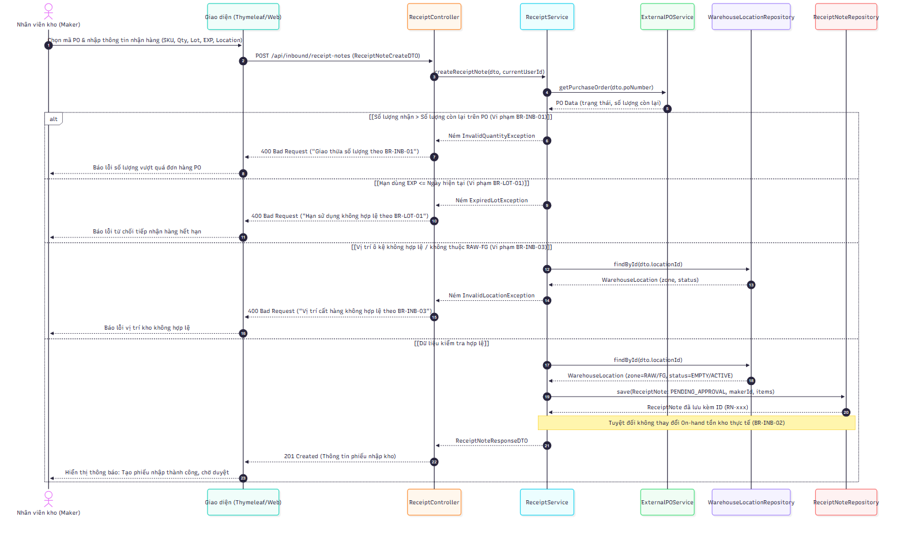
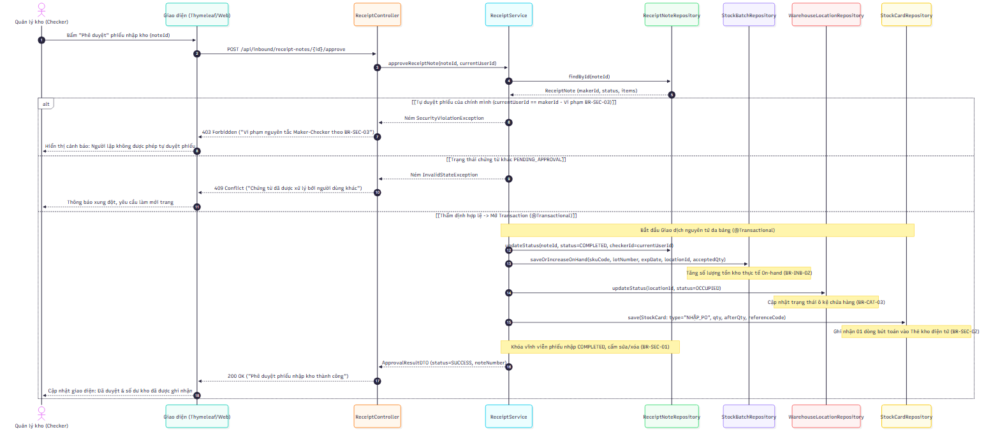
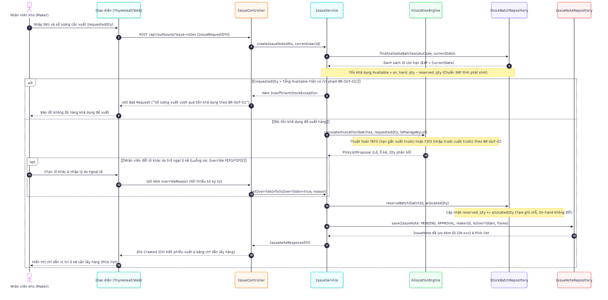

# BÁO CÁO THIẾT KẾ BIỂU ĐỒ TUẦN TỰ (SEQUENCE DIAGRAM)
**Học phần:** Phân tích và Thiết kế Yêu cầu (Mã môn: 502050 - ĐH Tôn Đức Thắng)  
**Nhiệm vụ:** `T2.4` (Sprint 2)  
**Người thực hiện (Maker):** M4 - Thạch Hoàng Quân  
**Người kiểm tra & Chuẩn hóa (Reviewer):** M1 - Nguyễn Thành Trung  
**Trạng thái đồng bộ:** Khớp 100% với Biểu đồ lớp phân tích (Class Diagram) và ERD 3NF (Task T2.3).

---

## 1. TỔNG QUAN KIẾN TRÚC & NGUYÊN TẮC THIẾT KẾ

Biểu đồ tuần tự (Sequence Diagram) mô hình hóa hành vi động và tương tác thông điệp giữa các đối tượng trong hệ thống SmartWMS theo kiến trúc phân tầng chuẩn của **Spring Boot 3.x**:

$$\text{Actor} \longrightarrow \text{Boundary (Thymeleaf/Web)} \longrightarrow \text{Controller} \longrightarrow \text{Service / Engine} \longrightarrow \text{Repository} \longrightarrow \text{Database Entity}$$

### Nguyên tắc đồng bộ 100% với Class Diagram & ERD (T2.3):
1. **Lớp Điều khiển (`<<Controller>>`):** Sử dụng chính xác các Controller đã tiền khai báo trong Class Diagram:
   - `ReceiptController`: Tiếp nhận cả tạo phiếu nhập (`createReceiptNote`) và duyệt phiếu nhập (`approveReceiptNote`).
   - `IssueController`: Tiếp nhận tạo phiếu xuất, phân bổ lô và giữ chỗ tồn kho (`createIssueNote`).
2. **Lớp Thực thể & Kho dữ liệu (`<<Repository>>`):** Ánh xạ 1-1 với 10 bảng của lược đồ ERD 3NF:
   - `ReceiptNoteRepository` $\leftrightarrow$ Bảng `receipt_note` & `receipt_note_item`
   - `StockBatchRepository` $\leftrightarrow$ Bảng `stock_batch`
   - `WarehouseLocationRepository` $\leftrightarrow$ Bảng `warehouse_location`
   - `StockCardRepository` $\leftrightarrow$ Bảng `stock_card`
   - `IssueNoteRepository` $\leftrightarrow$ Bảng `issue_note` & `issue_note_item`
3. **Chuẩn hóa Dữ liệu 3NF:** Tuyệt đối không lưu cột vật lý `available_qty`. Lượng tồn khả dụng được tính toán phái sinh theo công thức thời gian thực:  
   $$\text{Available Quantity} = \text{on\_hand\_qty} - \text{reserved\_qty}$$
4. **Kiểm soát Nội bộ & Maker-Checker (`BR-SEC-03`):** Kiểm tra độc lập quyền hạn người lập (`maker_id`) và người phê duyệt (`checker_id`), chặn đứng bằng mã lỗi `403 Forbidden` nếu vi phạm.

---

## 2. BIỂU ĐỒ TUẦN TỰ 1: LẬP PHIẾU NHẬP KHO THEO PO (UC02)

### 2.1. Biểu đồ chi tiết

### 2.2. Danh mục Lifelines tham gia
* **`Nhân viên kho (Maker)`** *(Actor)*: Người thực tế tiếp nhận hàng và kiểm đếm tại cửa kho.
* **`Giao diện (Thymeleaf/Web)`** *(Boundary)*: Form nhập liệu thông tin đơn PO, số lượng, số lô, hạn dùng và vị trí ô kệ cất hàng.
* **`ReceiptController`** *(Controller)*: Điểm tiếp nhận request `POST /api/inbound/receipt-notes`.
* **`ReceiptService`** *(Service)*: Thực thi logic kiểm tra đơn hàng, quy tắc hạn dùng và tính hợp lệ của vị trí kho.
* **`ExternalPOService`** *(External Service)*: Dịch vụ tích hợp tra cứu thông tin đơn đặt mua hàng (PO).
* **`WarehouseLocationRepository`** *(Repository)*: Kiểm tra vị trí kho dự kiến cất hàng thuộc phân vùng `RAW` hoặc `FG`.
* **`ReceiptNoteRepository`** *(Repository)*: Lưu trữ bản ghi phiếu nhập kho và các dòng hàng chi tiết.

### 2.3. Quy tắc nghiệp vụ & Luồng rẽ nhánh
1. **Kiểm tra vượt số lượng PO (`BR-INB-01`):** Nếu $\text{Quantity Received} > \text{Quantity Remaining}$, ném `InvalidQuantityException`, trả về `400 Bad Request`.
2. **Kiểm tra hạn sử dụng (`BR-LOT-01`):** Nếu $\text{EXP Date} \le \text{Current Date}$, ném `ExpiredLotException`, trả về `400 Bad Request` (từ chối nhận hàng hết hạn).
3. **Kiểm tra vị trí cất hàng (`BR-INB-03`):** Vị trí cất hàng bắt buộc phải thuộc phân vùng hợp lệ (`RAW`/`FG`) và đang ở trạng thái `EMPTY` hoặc `ACTIVE`. Nếu sai, ném `InvalidLocationException`, trả về `400 Bad Request`.
4. **Bảo toàn số dư kho (`BR-INB-02`):** Khi dữ liệu hợp lệ, hệ thống lưu phiếu ở trạng thái `PENDING_APPROVAL` kèm `maker_id`. **Tuyệt đối không tăng số lượng tồn kho thực tế (On-hand)** cho đến khi phiếu được phê duyệt. Hệ thống phản hồi `201 Created`.

---

## 3. BIỂU ĐỒ TUẦN TỰ 2: PHÊ DUYỆT PHIẾU NHẬP KHO (UC03)

### 3.1. Biểu đồ chi tiết

### 3.2. Danh mục Lifelines tham gia
* **`Quản lý kho (Checker)`** *(Actor)*: Người có thẩm quyền thẩm định và ra quyết định phê duyệt chứng từ nhập.
* **`Giao diện (Thymeleaf/Web)`** *(Boundary)*: Màn hình đối chiếu chứng từ 2 cột (Dữ liệu PO vs Dữ liệu Thực nhận).
* **`ReceiptController`** *(Controller)*: Điểm tiếp nhận request `POST /api/inbound/receipt-notes/{id}/approve`.
* **`ReceiptService`** *(Service)*: Thực thi kiểm tra thẩm quyền độc lập và quản lý giao dịch nguyên tử `@Transactional`.
* **`ReceiptNoteRepository`**: Cập nhật trạng thái phiếu nhập sang `COMPLETED`.
* **`StockBatchRepository`**: Tăng số lượng tồn kho vật lý (`on_hand_qty`) theo Lô và Vị trí.
* **`WarehouseLocationRepository`**: Cập nhật trạng thái vị trí ô kệ sang `OCCUPIED`.
* **`StockCardRepository`**: Ghi nhận dòng bút toán biến động vào Thẻ kho điện tử.

### 3.3. Quy tắc nghiệp vụ & Luồng rẽ nhánh
1. **Kiểm soát độc lập Maker-Checker (`BR-SEC-03`):**
   * Nếu `currentUserId == receiptNote.makerId`: Hệ thống lập tức chặn đứng, ném `SecurityViolationException`, trả về mã lỗi `403 Forbidden` (Người lập không được tự duyệt phiếu của chính mình).
2. **Chống xung đột xử lý đồng thời (`409 Conflict`):**
   * Nếu trạng thái chứng từ trong CSDL khác `PENDING_APPROVAL`, trả về `409 Conflict` để tránh duyệt trùng.
3. **Giao dịch nguyên tử đa bảng (`@Transactional`):** Khi thỏa mãn mọi điều kiện, Service kích hoạt transaction cập nhật đồng bộ:
   * Chuyển trạng thái phiếu sang `COMPLETED`, lưu `checkerId` và thời điểm duyệt.
   * Khóa vĩnh viễn phiếu nhập, nghiêm cấm chỉnh sửa hoặc xóa bỏ (`BR-SEC-01`).
   * Tăng số lượng tồn kho thực tế (*On-hand*) tương ứng tại bảng `stock_batch` (`BR-INB-02`).
   * Tự động chuyển trạng thái ô kệ sang `OCCUPIED` (`BR-CAT-03`).
   * Ghi 01 dòng lịch sử vào Thẻ kho (`stock_card`): Số chứng từ, loại `"NHẬP_PO"`, số lượng tăng, số tồn lũy kế sau giao dịch (`BR-SEC-02`).
   * Phản hồi `200 OK` báo phê duyệt thành công.

---

## 4. BIỂU ĐỒ TUẦN TỰ 3: LẬP PHIẾU XUẤT KHO & ĐỀ XUẤT XUẤT LÔ (UC04)

### 4.1. Biểu đồ chi tiết

### 4.2. Danh mục Lifelines tham gia
* **`Nhân viên kho (Maker)`** *(Actor)*: Người tạo yêu cầu xuất hàng theo lệnh sản xuất hoặc đơn bán.
* **`Giao diện (Thymeleaf/Web)`** *(Boundary)*: Form chọn SKU và nhập số lượng xuất.
* **`IssueController`** *(Controller)*: Điểm tiếp nhận request `POST /api/outbound/issue-notes`.
* **`IssueService`** *(Service)*: Điều phối kiểm tra tồn kho, kích hoạt thuật toán cấp phát và tạm giữ chỗ.
* **`AllocationEngine`** *(Algorithm Engine)*: Module thuật toán độc lập chịu trách nhiệm xếp thứ tự ưu tiên FEFO/FIFO và phân bổ ô kệ lấy hàng.
* **`StockBatchRepository`**: Truy vấn các lô còn hạn và cập nhật số lượng giữ chỗ (`reserved_qty`).
* **`IssueNoteRepository`**: Lưu phiếu xuất kho và các dòng chỉ dẫn lấy hàng (Pick list).

### 4.3. Quy tắc nghiệp vụ & Luồng rẽ nhánh
1. **Kiểm tra tồn kho khả dụng chống xuất âm (`BR-OUT-01`):**
   * Hệ thống truy vấn các lô có $\text{EXP Date} > \text{Current Date}$ (`BR-OUT-03`).
   * Tính toán tồn khả dụng: $\text{Available} = \text{on\_hand\_qty} - \text{reserved\_qty}$.
   * Nếu $\text{Requested Quantity} > \text{Available Quantity}$: Ném `InsufficientStockException`, trả về `400 Bad Request`.
2. **Thuật toán đề xuất xuất lô thông minh (`BR-OUT-02`):**
   * Đối với hàng quản lý theo lô: Sắp xếp theo hạn dùng gần nhất xuất trước (**FEFO**).
   * Đối với hàng thông thường: Sắp xếp theo ngày nhập cũ nhất xuất trước (**FIFO**).
   * Tự động sinh danh sách gợi ý lấy hàng chi tiết theo từng ô kệ (`PickListProposal` theo `BR-OUT-06`).
3. **Cơ chế Ghi đè ngoại lệ (Luồng 4a - Override FEFO/FIFO):**
   * Trường hợp trở ngại vật lý tại kho (kẹt pallet, lối đi bảo trì), nhân viên được chọn lô khác nhưng bắt buộc nhập lý do (`overrideReason`, tối thiểu 10 ký tự).
   * Hệ thống bật cờ `is_overridden = TRUE` trên phiếu xuất để Quản lý lưu ý khi duyệt.
4. **Cơ chế Tạm giữ chỗ (Reserve Stock):**
   * Service gọi `StockBatchRepository.reserveBatch(batchId, allocatedQty)`.
   * Cập nhật tăng `reserved_qty += allocatedQty`. Số lượng tồn thực tế `on_hand_qty` giữ nguyên không đổi (`BR-OUT-01`).
   * Lưu phiếu xuất kho với trạng thái `PENDING_APPROVAL` kèm `maker_id` và danh sách Pick list.
   * Phản hồi `201 Created` hiển thị bảng chỉ dẫn vị trí ô kệ cần lấy hàng.

---

## 5. BẢNG ĐỐI SOÁT ĐỒNG BỘ 100% VỚI CLASS DIAGRAM & ERD 3NF

| Thành phần trên Sequence Diagram | Lớp tương ứng trên Class Diagram (T2.3) | Bảng tương ứng trên ERD 3NF (T2.3) | Quy tắc nghiệp vụ chi phối | Ghi chú kỹ thuật |
| :--- | :--- | :--- | :---: | :--- |
| **`ReceiptController`** | `ReceiptController` | — | `BR-INB-01`, `02`, `BR-SEC-03` | Tiếp nhận tạo và duyệt nhập kho. |
| **`IssueController`** | `IssueController` | — | `BR-OUT-01`, `02`, `BR-SEC-03` | Tiếp nhận tạo và xác nhận xuất kho. |
| **`ReceiptNoteRepository`** | `ReceiptNote`, `ReceiptNoteItem` | `receipt_note`, `receipt_note_item` | `BR-INB-01`, `BR-SEC-01` | Lưu Header-Detail quan hệ Composition. |
| **`StockBatchRepository`** | `StockBatch` | `stock_batch` | `BR-LOT-01`, `BR-OUT-01`, `04` | Thực thể trung tâm quản lý Lô, On-hand và Reserved. |
| **`WarehouseLocationRepository`** | `WarehouseLocation` | `warehouse_location` | `BR-CAT-02`, `BR-CAT-03`, `BR-INB-03` | Quản lý vị trí ô kệ 3M và trạng thái EMPTY/OCCUPIED. |
| **`StockCardRepository`** | `StockCard` | `stock_card` | `BR-SEC-02` | Thẻ kho lưu biến động lịch sử xuất nhập. |
| **`IssueNoteRepository`** | `IssueNote`, `IssueNoteItem` | `issue_note`, `issue_note_item` | `BR-OUT-01`, `02`, `06` | Lưu phiếu xuất, Pick list, cờ `is_overridden`. |
| **`AllocationEngine`** | Tiền khai báo Component | — | `BR-OUT-02` | Module thuật toán cấp phát FEFO/FIFO độc lập. |
| **`ExternalPOService`** | Interface tích hợp | `receipt_note.po_number` | `BR-INB-01` | Mock đối soát đơn mua hàng từ hệ thống ERP/Purchasing. |

---

## 6. KẾT LUẬN & ĐỀ NGHỊ DUYỆT (VERDICT)

Toàn bộ 3 biểu đồ tuần tự trọng tâm đã được hoàn thiện, render trực tiếp từ mã nguồn Mermaid chuẩn mực, đạt độ phân giải cao và đồng bộ 100% với Biểu đồ lớp phân tích và Lược đồ CSDL 3NF:
* Đã khử triệt để sự sai lệch về tên gọi Controller (`ReceiptController`, `IssueController`).
* Đã chuẩn hóa đúng tên `WarehouseLocationRepository` và cấu trúc bảng `warehouse_location`.
* Đã phản ánh chuẩn mực lý thuyết 3NF (không thao tác update cột dư thừa `available_qty`, chỉ cập nhật `reserved_qty`).
* Đã bổ sung đầy đủ luồng ngoại lệ Vị trí kho (`BR-INB-03`) và Ghi đè lô FEFO/FIFO (`is_overridden`).

👉 **Đề xuất:** Duyệt thông qua nhiệm vụ **`T2.4`** và cập nhật [SprintPlan_PhanCong.md](../../SprintPlan_PhanCong.md) sang trạng thái **Hoàn thành**.
