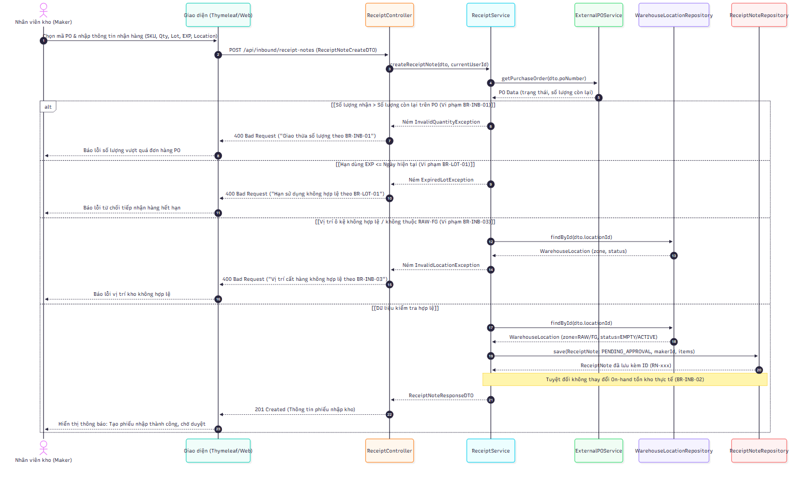
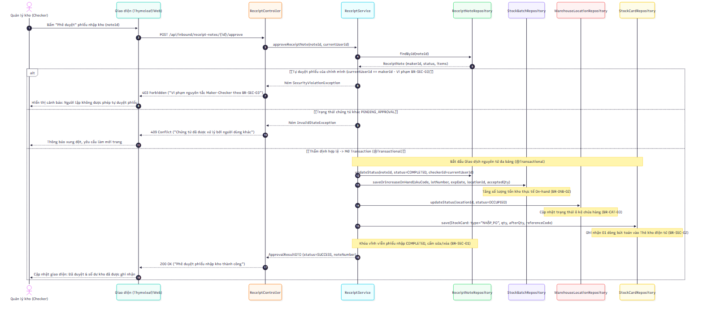
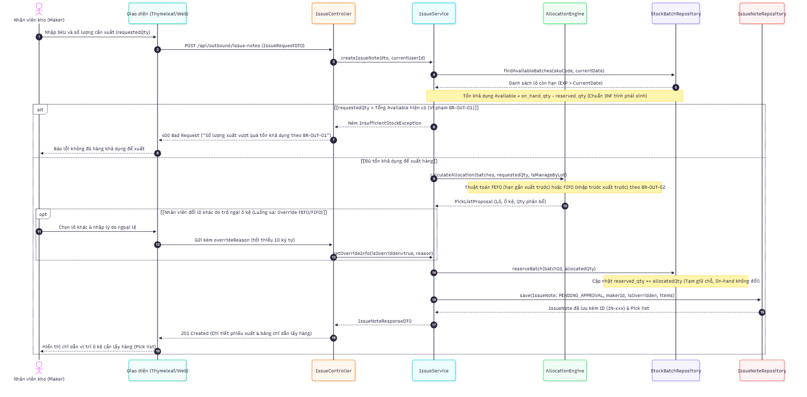

# BÁO CÁO THIẾT KẾ BIỂU ĐỒ TUẦN TỰ (SEQUENCE DIAGRAM)
**Học phần:** Phân tích và Thiết kế Yêu cầu (Mã môn: 502050 - ĐH Tôn Đức Thắng)  
**Nhiệm vụ:** `T2.4` (Sprint 2) | **Maker:** M4 - Thạch Hoàng Quân | **Reviewer:** M1 - Nguyễn Thành Trung  
**Trạng thái đồng bộ:** Khớp 100% với Biểu đồ lớp phân tích (Class Diagram) và ERD 3NF (Task T2.3).

---

## 1. TỔNG QUAN KIẾN TRÚC & NGUYÊN TẮC THIẾT KẾ

Mô hình hóa tương tác Spring Boot 3.x theo luồng đa tầng:
$$\text{Actor} \longrightarrow \text{Boundary (Thymeleaf/Web)} \longrightarrow \text{Controller} \longrightarrow \text{Service / Engine} \longrightarrow \text{Repository} \longrightarrow \text{Database Entity}$$

### Nguyên tắc đồng bộ với Class Diagram & ERD (T2.3)
* **Controller:** Dùng đúng 2 Controller tiền khai báo (`ReceiptController`, `IssueController`).
* **Repository:** Map 1-1 với các bảng ERD (`ReceiptNoteRepository`, `StockBatchRepository`, `WarehouseLocationRepository`, `StockCardRepository`, `IssueNoteRepository`).
* **Chuẩn 3NF:** Không lưu cột `available_qty`, tính động: $\text{Available} = \text{on\_hand\_qty} - \text{reserved\_qty}$.
* **Maker-Checker:** Bắt buộc $\text{checker\_id} \ne \text{maker\_id}$ (`BR-SEC-03`), chặn bằng mã `403 Forbidden`.

---

## 2. BIỂU ĐỒ TUẦN TỰ 1: LẬP PHIẾU NHẬP KHO THEO PO (UC02)

### 2.1. Biểu đồ chi tiết

### 2.2. Danh mục Lifelines
* **`Nhân viên kho (Maker)`**: Người tiếp nhận hàng và kiểm đếm.
* **`Giao diện (Thymeleaf/Web)`**: Form nhập thông tin PO, số lượng, lô, hạn dùng và vị trí.
* **`ReceiptController`**: Endpoint `POST /api/inbound/receipt-notes`.
* **`ReceiptService`**: Xử lý logic nghiệp vụ và kiểm tra điều kiện nhập.
* **`ExternalPOService`**: Tích hợp tra cứu đơn mua hàng PO.
* **`WarehouseLocationRepository`**: Xác thực vị trí kho (`warehouse_location`).
* **`ReceiptNoteRepository`**: Lưu dữ liệu phiếu nhập (`receipt_note`, `receipt_note_item`).

### 2.3. Giải trình chi tiết 23 bước tương tác (Step-by-Step Breakdown)

| Bước | Bên gửi $\rightarrow$ Bên nhận | Thông điệp / Thao tác | Giải trình nghiệp vụ & Quy tắc BR |
| :---: | :--- | :--- | :--- |
| **1** | Maker $\rightarrow$ Giao diện | Nhập thông tin nhận hàng | Chọn mã PO, nhập SKU, số lượng nhận, số lô, hạn dùng, vị trí kho. |
| **2** | Giao diện $\rightarrow$ ReceiptController | `POST /api/inbound/receipt-notes` | Đóng gói dữ liệu gửi lên API qua `ReceiptNoteCreateDTO`. |
| **3** | ReceiptController $\rightarrow$ ReceiptService | `createReceiptNote(dto, userId)` | Chuyển dữ liệu xuống tầng Service xử lý nghiệp vụ. |
| **4** | ReceiptService $\rightarrow$ ExternalPOService | `getPurchaseOrder(poNumber)` | Truy vấn thông tin đơn mua hàng từ hệ thống ngoài. |
| **5** | ExternalPOService $\rightarrow$ ReceiptService | PO Data (trạng thái, tồn PO) | Trả về thông tin PO: trạng thái duyệt và số lượng còn lại. |
| **6** | ReceiptService $\rightarrow$ ReceiptController | *Ném `InvalidQuantityException`* | **[Nhánh lỗi 1]** Số lượng nhận > số lượng còn lại trên PO (`BR-INB-01`). |
| **7** | ReceiptController $\rightarrow$ Giao diện | `400 Bad Request` | Báo lỗi giao thừa số lượng theo quy định từ chối nhận hàng thừa. |
| **8** | Giao diện $\rightarrow$ Maker | Báo lỗi vượt số lượng PO | Hiển thị cảnh báo lỗi số lượng vượt quá đơn hàng cho nhân viên. |
| **9** | ReceiptService $\rightarrow$ ReceiptController | *Ném `ExpiredLotException`* | **[Nhánh lỗi 2]** Hạn sử dụng $\text{EXP} \le \text{Current Date}$ (`BR-LOT-01`). |
| **10** | ReceiptController $\rightarrow$ Giao diện | `400 Bad Request` | Báo lỗi hạn sử dụng không hợp lệ, từ chối nhận hàng hết hạn. |
| **11** | Giao diện $\rightarrow$ Maker | Báo từ chối nhận hàng hết hạn | Hiển thị thông báo hàng cận/hết hạn bị từ chối nhập kho. |
| **12** | ReceiptService $\rightarrow$ WarehouseLocationRepository | `findById(locationId)` | **[Nhánh lỗi 3]** Truy vấn vị trí ô kệ cất hàng dự kiến (`BR-INB-03`). |
| **13** | WarehouseLocationRepository $\rightarrow$ ReceiptService | `WarehouseLocation (zone, status)` | Trả về thông tin phân vùng và trạng thái vị trí ô kệ. |
| **14** | ReceiptService $\rightarrow$ ReceiptController | *Ném `InvalidLocationException`* | Vị trí không thuộc vùng `RAW`/`FG` hoặc không sẵn sàng (`BR-INB-03`). |
| **15** | ReceiptController $\rightarrow$ Giao diện | `400 Bad Request` | Báo lỗi vị trí cất hàng không hợp lệ theo chuẩn 3M. |
| **16** | Giao diện $\rightarrow$ Maker | Báo lỗi vị trí không hợp lệ | Yêu cầu nhân viên chỉ định lại vị trí ô kệ đạt chuẩn. |
| **17** | ReceiptService $\rightarrow$ WarehouseLocationRepository | `findById(locationId)` | **[Luồng hợp lệ]** Kiểm tra xác nhận vị trí ô kệ đạt yêu cầu. |
| **18** | WarehouseLocationRepository $\rightarrow$ ReceiptService | `WarehouseLocation (RAW/FG, EMPTY)` | Vị trí hợp lệ, sẵn sàng tiếp nhận hàng hóa. |
| **19** | ReceiptService $\rightarrow$ ReceiptNoteRepository | `save(ReceiptNote, items)` | Lưu phiếu trạng thái `PENDING_APPROVAL`, gán `makerId` (`BR-SEC-02`). |
| **20** | ReceiptNoteRepository $\rightarrow$ ReceiptService | `ReceiptNote đã lưu kèm ID` | Ghi nhận bản ghi thành công. **Tồn On-hand giữ nguyên** (`BR-INB-02`). |
| **21** | ReceiptService $\rightarrow$ ReceiptController | `ReceiptNoteResponseDTO` | Trả DTO thông tin phiếu nhập kho đã khởi tạo. |
| **22** | ReceiptController $\rightarrow$ Giao diện | `201 Created` | Phản hồi HTTP 201 kèm mã số phiếu nhập kho mới. |
| **23** | Giao diện $\rightarrow$ Maker | Thông báo tạo phiếu thành công | Hiển thị thông báo phiếu đã lập thành công và đang chờ Quản lý duyệt. |

---

## 3. BIỂU ĐỒ TUẦN TỰ 2: PHÊ DUYỆT PHIẾU NHẬP KHO (UC03)

### 3.1. Biểu đồ chi tiết

### 3.2. Danh mục Lifelines
* **`Quản lý kho (Checker)`**: Người thẩm định và duyệt chứng từ.
* **`Giao diện (Thymeleaf/Web)`**: Màn hình đối chiếu chứng từ thẩm định.
* **`ReceiptController`**: Endpoint `POST /api/inbound/receipt-notes/{id}/approve`.
* **`ReceiptService`**: Kiểm tra Maker-Checker và điều phối giao dịch `@Transactional`.
* **`ReceiptNoteRepository`**: Cập nhật trạng thái phiếu (`receipt_note`).
* **`StockBatchRepository`**: Tăng số dư tồn kho thực tế (`stock_batch`).
* **`WarehouseLocationRepository`**: Cập nhật trạng thái ô kệ (`warehouse_location`).
* **`StockCardRepository`**: Ghi bút toán thẻ kho (`stock_card`).

### 3.3. Giải trình chi tiết 18 bước tương tác (Step-by-Step Breakdown)

| Bước | Bên gửi $\rightarrow$ Bên nhận | Thông điệp / Thao tác | Giải trình nghiệp vụ & Quy tắc BR |
| :---: | :--- | :--- | :--- |
| **1** | Checker $\rightarrow$ Giao diện | Bấm "Phê duyệt" phiếu nhập | Quản lý kho xem xét đối chiếu số liệu và bấm duyệt phiếu. |
| **2** | Giao diện $\rightarrow$ ReceiptController | `POST .../{id}/approve` | Gửi yêu cầu phê duyệt phiếu nhập kèm ID chứng từ. |
| **3** | ReceiptController $\rightarrow$ ReceiptService | `approveReceiptNote(id, userId)` | Kích hoạt logic thẩm định và phê duyệt ở tầng Service. |
| **4** | ReceiptService $\rightarrow$ ReceiptNoteRepository | `findById(noteId)` | Truy vấn thông tin chi tiết phiếu nhập kho cần duyệt. |
| **5** | ReceiptNoteRepository $\rightarrow$ ReceiptService | `ReceiptNote (makerId, status)` | Trả về dữ liệu phiếu: người tạo (`makerId`), trạng thái, chi tiết lô. |
| **6** | ReceiptService $\rightarrow$ ReceiptController | *Ném `SecurityViolationException`* | **[Nhánh lỗi 1]** `currentUserId == makerId`: Tự duyệt phiếu của mình (`BR-SEC-03`). |
| **7** | ReceiptController $\rightarrow$ Giao diện | `403 Forbidden` | Cảnh báo vi phạm bảo mật kiểm soát 4 mắt (Maker-Checker). |
| **8** | Giao diện $\rightarrow$ Checker | Thông báo không được tự duyệt | Hiển thị thông báo từ chối quyền duyệt phiếu cho người tạo. |
| **9** | ReceiptService $\rightarrow$ ReceiptController | *Ném `InvalidStateException`* | **[Nhánh lỗi 2]** Trạng thái khác `PENDING_APPROVAL` (đã duyệt/từ chối). |
| **10** | ReceiptController $\rightarrow$ Giao diện | `409 Conflict` | Xung đột trạng thái chứng từ do thao tác đồng thời. |
| **11** | Giao diện $\rightarrow$ Checker | Yêu cầu làm mới trang | Yêu cầu người dùng tải lại danh sách để cập nhật trạng thái mới. |
| **12** | ReceiptService $\rightarrow$ ReceiptNoteRepository | `updateStatus(COMPLETED)` | **[Giao dịch @Transactional]** Đổi sang `COMPLETED`, lưu `checkerId`, khóa phiếu (`BR-SEC-01`). |
| **13** | ReceiptService $\rightarrow$ StockBatchRepository | `saveOrIncreaseOnHand(...)` | **Chính thức tăng tồn kho thực tế On-hand** theo Lô & Vị trí (`BR-INB-02`). |
| **14** | ReceiptService $\rightarrow$ WarehouseLocationRepository | `updateStatus(OCCUPIED)` | Chuyển trạng thái ô kệ chứa hàng sang `OCCUPIED` (`BR-CAT-03`). |
| **15** | ReceiptService $\rightarrow$ StockCardRepository | `save(StockCard: NHẬP_PO)` | Ghi sổ Thẻ kho điện tử: số lượng tăng, tồn lũy kế (`BR-SEC-02`). |
| **16** | ReceiptService $\rightarrow$ ReceiptController | `ApprovalResultDTO` | Hoàn tất giao dịch nguyên tử, trả kết quả thành công. |
| **17** | ReceiptController $\rightarrow$ Giao diện | `200 OK` | Phản hồi HTTP 200 báo duyệt phiếu nhập kho thành công. |
| **18** | Giao diện $\rightarrow$ Checker | Cập nhật giao diện thành công | Hiển thị trạng thái đã duyệt và số dư kho đã được cập nhật. |

---

## 4. BIỂU ĐỒ TUẦN TỰ 3: LẬP PHIẾU XUẤT KHO & ĐỀ XUẤT XUẤT LÔ (UC04)

### 4.1. Biểu đồ chi tiết

### 4.2. Danh mục Lifelines
* **`Nhân viên kho (Maker)`**: Người tạo yêu cầu xuất hàng.
* **`Giao diện (Thymeleaf/Web)`**: Form chọn SKU và nhập số lượng xuất.
* **`IssueController`**: Endpoint `POST /api/outbound/issue-notes`.
* **`IssueService`**: Điều phối nghiệp vụ xuất, giữ chỗ và cấp phát lô.
* **`AllocationEngine`**: Module xử lý thuật toán phân bổ FEFO/FIFO độc lập.
* **`StockBatchRepository`**: Quản lý tồn kho lô (`reserved_qty`).
* **`IssueNoteRepository`**: Lưu phiếu xuất kho (`issue_note`, `issue_note_item`).

### 4.3. Giải trình chi tiết 19 bước tương tác (Step-by-Step Breakdown)

| Bước | Bên gửi $\rightarrow$ Bên nhận | Thông điệp / Thao tác | Giải trình nghiệp vụ & Quy tắc BR |
| :---: | :--- | :--- | :--- |
| **1** | Maker $\rightarrow$ Giao diện | Nhập SKU & số lượng xuất | Nhân viên nhập mã mặt hàng và số lượng cần xuất (`requestedQty`). |
| **2** | Giao diện $\rightarrow$ IssueController | `POST /api/outbound/issue-notes` | Đóng gói `IssueRequestDTO` gửi yêu cầu tạo lệnh xuất. |
| **3** | IssueController $\rightarrow$ IssueService | `createIssueNote(dto, userId)` | Chuyển tiếp yêu cầu xuống Service xử lý kiểm tra tồn và cấp phát. |
| **4** | IssueService $\rightarrow$ StockBatchRepository | `findAvailableBatches(sku, date)` | Truy vấn danh sách các lô hàng còn hạn ($\text{EXP} > \text{Current Date}$). |
| **5** | StockBatchRepository $\rightarrow$ IssueService | Danh sách lô còn hạn | Trả về các lô khả dụng (tính $\text{Available} = \text{on\_hand} - \text{reserved}$ theo 3NF). |
| **6** | IssueService $\rightarrow$ IssueController | *Ném `InsufficientStockException`* | **[Nhánh lỗi]** $\text{Requested} > \text{Available}$: Vượt tồn khả dụng (`BR-OUT-01`). |
| **7** | IssueController $\rightarrow$ Giao diện | `400 Bad Request` | Chặn xuất âm, báo lỗi không đủ tồn kho khả dụng để cấp phát. |
| **8** | Giao diện $\rightarrow$ Maker | Báo không đủ hàng xuất | Hiển thị cảnh báo số lượng tồn khả dụng không đáp ứng yêu cầu. |
| **9** | IssueService $\rightarrow$ AllocationEngine | `calculateAllocation(...)` | **[Đủ tồn]** Kích hoạt thuật toán phân bổ lô theo FEFO/FIFO (`BR-OUT-02`). |
| **10** | AllocationEngine $\rightarrow$ IssueService | `PickListProposal (Lô, Ô kệ)` | Trả về phương án phân bổ lô hạn ngắn trước và vị trí ô kệ cần lấy. |
| **11** | Maker $\rightarrow$ Giao diện | Chọn đổi lô & nhập lý do | **[Luồng 4a - Override]** Nhân viên đổi lô do trở ngại vật lý ô kệ. |
| **12** | Giao diện $\rightarrow$ IssueController | Gửi kèm `overrideReason` | Chuyển lý do giải trình ngoại lệ (tối thiểu 10 ký tự) lên hệ thống. |
| **13** | IssueController $\rightarrow$ IssueService | `setOverrideInfo(true, reason)` | Bật cờ `is_overridden = TRUE` và lưu lý do vào thực thể `issue_note`. |
| **14** | IssueService $\rightarrow$ StockBatchRepository | `reserveBatch(batchId, qty)` | **Cơ chế Tạm giữ chỗ:** Cập nhật `reserved_qty += allocatedQty` (`BR-OUT-01`). |
| **15** | IssueService $\rightarrow$ IssueNoteRepository | `save(IssueNote, items)` | Lưu phiếu xuất trạng thái `PENDING_APPROVAL` kèm danh sách Pick list. |
| **16** | IssueNoteRepository $\rightarrow$ IssueService | `IssueNote đã lưu kèm ID` | Ghi nhận chứng từ xuất thành công vào cơ sở dữ liệu. |
| **17** | IssueService $\rightarrow$ IssueController | `IssueNoteResponseDTO` | Trả DTO thông tin phiếu xuất và chỉ dẫn bốc dỡ ô kệ. |
| **18** | IssueController $\rightarrow$ Giao diện | `201 Created` | Phản hồi HTTP 201 kèm mã chứng từ và chi tiết Pick list. |
| **19** | Giao diện $\rightarrow$ Maker | Hiển thị chỉ dẫn Pick list | Trực quan hóa danh sách các ô kệ cần đến lấy hàng cho nhân viên. |

---

## 5. BẢNG ĐỐI SOÁT ĐỒNG BỘ VỚI CLASS DIAGRAM & ERD 3NF

| Thành phần Sequence | Class Diagram (T2.3) | Bảng ERD 3NF (T2.3) | Quy tắc BR | Vai trò kỹ thuật |
| :--- | :--- | :--- | :---: | :--- |
| **`ReceiptController`** | `ReceiptController` | — | `BR-INB-01`, `02`, `BR-SEC-03` | Tiếp nhận tạo và duyệt nhập kho. |
| **`IssueController`** | `IssueController` | — | `BR-OUT-01`, `02`, `BR-SEC-03` | Tiếp nhận tạo và xác nhận xuất kho. |
| **`ReceiptNoteRepository`** | `ReceiptNote`, `ReceiptNoteItem` | `receipt_note`, `receipt_note_item` | `BR-INB-01`, `BR-SEC-01` | Quản lý Header-Detail phiếu nhập (Composition). |
| **`StockBatchRepository`** | `StockBatch` | `stock_batch` | `BR-LOT-01`, `BR-OUT-01`, `04` | Cập nhật On-hand và Reserved theo Lô & Vị trí. |
| **`WarehouseLocationRepository`** | `WarehouseLocation` | `warehouse_location` | `BR-CAT-02`, `03`, `BR-INB-03` | Kiểm tra vị trí kho 3M và trạng thái ô kệ. |
| **`StockCardRepository`** | `StockCard` | `stock_card` | `BR-SEC-02` | Sổ cái Thẻ kho điện tử lưu vết biến động. |
| **`IssueNoteRepository`** | `IssueNote`, `IssueNoteItem` | `issue_note`, `issue_note_item` | `BR-OUT-01`, `02`, `06` | Quản lý Header-Detail phiếu xuất và cờ ghi đè lô. |
| **`AllocationEngine`** | Component tiền khai báo | — | `BR-OUT-02` | Module thuật toán cấp phát lô FEFO/FIFO độc lập. |
| **`ExternalPOService`** | Interface tích hợp | `receipt_note.po_number` | `BR-INB-01` | Mock đối soát đơn mua hàng ngoài. |

---

## 6. KẾT LUẬN & ĐỀ NGHỊ DUYỆT (VERDICT)

Toàn bộ 3 biểu đồ tuần tự đã được giải trình chi tiết từng bước (23 bước SQ01, 18 bước SQ02, 19 bước SQ03), khớp 100% với kiến trúc Class Diagram và Lược đồ ERD 3NF.

👉 **Đề xuất:** Duyệt thông qua nhiệm vụ **`T2.4`** trong [SprintPlan_PhanCong.md](../../SprintPlan_PhanCong.md).
