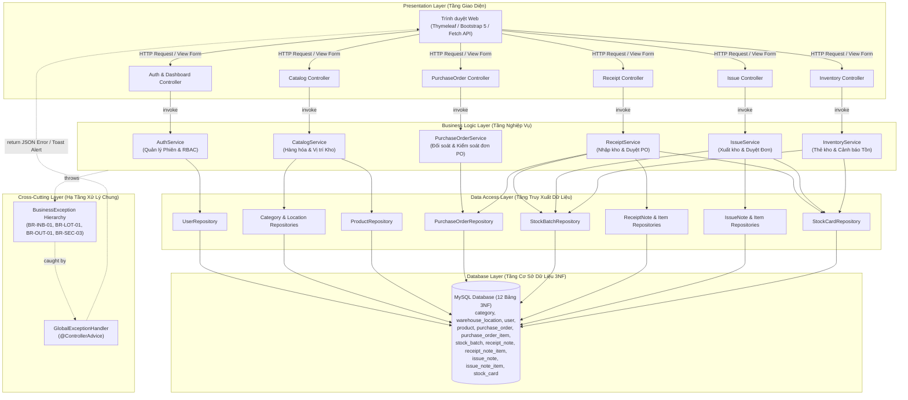

# BÁO CÁO THIẾT KẾ THÀNH PHẦN & TỔ CHỨC PACKAGE SPRING BOOT (COMPONENT DESIGN SPECIFICATION)

---

## MỤC LỤC TỔNG QUAN

1. [Tổng quan Kiến trúc Phân tầng Hệ thống (System Layered Architecture)](#1-tổng-quan-kiến-trúc-phân-tầng-hệ-thống-system-layered-architecture)
2. [Biểu đồ Thành phần UML (UML Component Diagram)](#2-biểu-đồ-thành-phần-uml-uml-component-diagram)
3. [Tổ chức Cấu trúc Package Spring Boot Chuẩn (Package Layout)](#3-tổ-chức-cấu-trúc-package-spring-boot-chuẩn-package-layout)
4. [Thiết kế Kiến trúc Xử lý Ngoại lệ Tập trung (Exception Handling Architecture)](#4-thiết-kế-kiến-trúc-xử-lý-ngoại-lệ-tập-trung-exception-handling-architecture)
5. [Ma trận Phân bổ Trách nhiệm (Component Responsibility Matrix)](#5-ma-trận-phân-bổ-trách-nhiệm-component-responsibility-matrix)
6. [Kết luận & Đánh giá sự Đồng bộ của Task T3.3](#6-kết-luận--đánh-giá-sự-đồng-bộ-của-task-t33)

---

## 1. TỔNG QUAN KIẾN TRÚC PHÂN TẦNG HỆ THỐNG (SYSTEM LAYERED ARCHITECTURE)

Hệ thống SmartWMS được thiết kế dựa trên nền tảng **Spring Boot 3.3.4 (Java 17)** tuân thủ nghiêm ngặt **Kiến trúc Phân lớp Chuẩn (Layered Architecture)** kết hợp các nguyên lý thiết kế hướng đối tượng **SOLID**, nhằm phân tách rành mạch các mối quan tâm (Separation of Concerns - SoC) và đảm bảo tính khả bảo trì, khả kiểm thử.

```
+-----------------------------------------------------------------------------------+
|                           PRESENTATION LAYER (Web / UI)                           |
|       - Spring MVC Controllers (@Controller) render Thymeleaf HTML5 + Bootstrap 5  |
|       - REST Controllers (@RestController) phục vụ Fetch API / JSON DTO            |
+-----------------------------------------------------------------------------------+
                                          │
                                          ▼  (Unidirectional: DTO Payloads)
+-----------------------------------------------------------------------------------+
|                        BUSINESS LOGIC LAYER (Core Services)                       |
|       - Service Interfaces & Implementations (@Service, @Transactional)           |
|       - Kiểm tra 100% Business Rules (BR-INB-01, BR-LOT-01, BR-OUT-01, BR-SEC-03)   |
|       - Xử lý các luồng nghiệp vụ quản lý nhập kho, xuất kho FEFO/FIFO, thẻ kho    |
+-----------------------------------------------------------------------------------+
                                          │
                                          ▼  (Unidirectional: Entity Models)
+-----------------------------------------------------------------------------------+
|                         DATA ACCESS LAYER (Persistence / ORM)                     |
|       - Spring Data JPA Repositories (JpaRepository<T, ID>)                       |
|       - JPQL Queries, Khóa bi quan/lạc quan (Pessimistic / Optimistic Locking)    |
|       - Hibernate ORM mapping với CSDL quan hệ 3NF                                 |
+-----------------------------------------------------------------------------------+
                                          │
                                          ▼  (JDBC Driver / Connection Pool)
+-----------------------------------------------------------------------------------+
|                        DATABASE LAYER (Relational Storage)                        |
|       - MySQL 8.x InnoDB Engine (Hoặc H2 In-Memory chạy kiểm thử / demo dự phòng)  |
|       - 12 Bảng chuẩn hóa 3NF, Ràng buộc Khóa chính, Khóa ngoại, Bảng chỉ mục IDX  |
+-----------------------------------------------------------------------------------+
                                          ▲
                                          │  (Cross-cutting Concerns)
+-----------------------------------------------------------------------------------+
|                        CROSS-CUTTING / INFRASTRUCTURE LAYER                       |
|       - Global Exception Handler (@ControllerAdvice) đón bắt BusinessException    |
|       - Bean Validation Engine (@Valid, @NotNull, @Min)                           |
|       - Security & Session Management (Maker-Checker, RBAC)                       |
+-----------------------------------------------------------------------------------+
```

### Nguyên tắc Ràng buộc Phụ thuộc Một chiều (Unidirectional Dependency Rule)
1. **Controller $\rightarrow$ Service:** Controller chỉ tiếp nhận HTTP Request, giải mã dữ liệu vào DTO, chuyển giao quyền xử lý cho Service tương ứng và điều hướng View / JSON. Tuyệt đối không viết logic nghiệp vụ (tính toán số lượng, trừ kho, tính giá trị...) trong Controller.
2. **Service $\rightarrow$ Repository:** Toàn bộ thao tác truy vấn và biến đổi dữ liệu CSDL bắt buộc thực hiện thông qua Repository. Controller tuyệt đối không được gọi trực tiếp Repository.
3. **Repository $\rightarrow$ Entity:** Repository chỉ quản lý vòng đời và truy vấn các thực thể `@Entity` tương ứng.
4. **Bảo toàn Giao dịch ACID (`@Transactional`):** Tất cả các phương thức Service làm biến động dữ liệu từ 2 bảng trở lên (đặc biệt là duyệt nhập kho `approveReceipt` và duyệt xuất kho `approveIssue`) bắt buộc khai báo `@Transactional(rollbackFor = Exception.class)`. Nếu có bất kỳ vi phạm ràng buộc nào xảy ra, toàn bộ giao dịch lập tức bị Rollback về trạng thái an toàn ban đầu.

---

## 2. BIỂU ĐỒ THÀNH PHẦN UML (UML COMPONENT DIAGRAM)

Biểu đồ Thành phần (Component Diagram) thể hiện mối liên kết cấu trúc giữa các khối chức năng nghiệp vụ, cổng giao tiếp (Interface) và hạ tầng lưu trữ của hệ thống SmartWMS:



---

## 3. TỔ CHỨC CẤU TRÚC PACKAGE SPRING BOOT CHUẨN (PACKAGE LAYOUT)

Áp dụng phương án tổ chức **Package-by-Feature cho DTO** kết hợp **Package-by-Layer cho các tầng chính**, đảm bảo độ gắn kết cao (High Cohesion) và mức phụ thuộc thấp (Low Coupling).

### 3.1. Sơ đồ Cây Thư mục Dự kiến

```text
source/
├── pom.xml                                         # Maven Project Object Model
├── README.md                                       # Hướng dẫn kiến trúc & build
└── src/
    ├── main/
    │   ├── java/com/wms/
    │   │   ├── WmsApplication.java                 # Entry point khởi chạy Spring Boot
    │   │   │
    │   │   ├── config/                             # Cấu hình Spring (JPA, Security, WebMvc)
    │   │   │   └── WebMvcConfig.java
    │   │   │
    │   │   ├── controller/                         # Tầng Presentation tiếp nhận HTTP
    │   │   │   ├── AuthController.java             # Đăng nhập, đăng xuất, điều hướng Dashboard
    │   │   │   ├── CatalogController.java          # Quản lý hàng hóa SKU, danh mục & ô kệ kho
    │   │   │   ├── PurchaseOrderController.java    # Quản lý đơn mua hàng PO & kiểm soát giao hàng
    │   │   │   ├── ReceiptController.java          # Lập & duyệt phiếu nhập kho (UC02, UC03)
    │   │   │   ├── IssueController.java            # Lập & duyệt phiếu xuất kho FEFO (UC04, UC05)
    │   │   │   └── InventoryController.java        # Tra cứu thẻ kho & cảnh báo tồn (UC06, UC07)
    │   │   │
    │   │   ├── service/                            # Tầng Business Logic (Service Interfaces)
    │   │   │   ├── AuthService.java
    │   │   │   ├── CatalogService.java
    │   │   │   ├── PurchaseOrderService.java       # Đối soát đơn mua hàng PO & tính tồn chưa giao
    │   │   │   ├── ReceiptService.java
    │   │   │   ├── IssueService.java
    │   │   │   ├── InventoryService.java
    │   │   │   │
    │   │   │   └── impl/                           # Lớp hiện thực Service (@Service)
    │   │   │       ├── AuthServiceImpl.java
    │   │   │       ├── CatalogServiceImpl.java
    │   │   │       ├── PurchaseOrderServiceImpl.java   # Nghiệp vụ đối soát PO & chống nhận thừa
    │   │   │       ├── ReceiptServiceImpl.java     # Xử lý giao dịch nhập @Transactional
    │   │   │       ├── IssueServiceImpl.java       # Xử lý giao dịch xuất @Transactional
    │   │   │       └── InventoryServiceImpl.java
    │   │   │
    │   │   ├── repository/                         # Tầng Data Access (Spring Data JPA)
    │   │   │   ├── CategoryRepository.java         # CRUD bảng category
    │   │   │   ├── WarehouseLocationRepository.java# CRUD bảng warehouse_location
    │   │   │   ├── UserRepository.java              # CRUD bảng user
    │   │   │   ├── ProductRepository.java           # CRUD bảng product
    │   │   │   ├── PurchaseOrderRepository.java     # CRUD bảng purchase_order & đối soát PO
    │   │   │   ├── StockBatchRepository.java        # CRUD & truy vấn lô bảng stock_batch
    │   │   │   ├── ReceiptNoteRepository.java       # CRUD bảng receipt_note
    │   │   │   ├── ReceiptNoteItemRepository.java   # CRUD bảng receipt_note_item
    │   │   │   ├── IssueNoteRepository.java         # CRUD bảng issue_note
    │   │   │   ├── IssueNoteItemRepository.java     # CRUD bảng issue_note_item
    │   │   │   └── StockCardRepository.java         # CRUD bảng stock_card
    │   │   │
    │   │   ├── entity/                             # Tầng Domain Models (@Entity 3NF)
    │   │   │   ├── Category.java
    │   │   │   ├── WarehouseLocation.java
    │   │   │   ├── User.java
    │   │   │   ├── Product.java
    │   │   │   ├── PurchaseOrder.java
    │   │   │   ├── PurchaseOrderItem.java
    │   │   │   ├── StockBatch.java
    │   │   │   ├── ReceiptNote.java
    │   │   │   ├── ReceiptNoteItem.java
    │   │   │   ├── IssueNote.java
    │   │   │   ├── IssueNoteItem.java
    │   │   │   └── StockCard.java
    │   │   │
    │   │   ├── dto/                                # Data Transfer Objects (Package-by-Feature)
    │   │   │   ├── auth/                           # DTO phân hệ xác thực
    │   │   │   │   ├── LoginRequestDTO.java
    │   │   │   │   └── UserResponseDTO.java
    │   │   │   ├── catalog/                        # DTO phân hệ danh mục hàng hóa & ô kệ
    │   │   │   │   ├── ProductCreateDTO.java
    │   │   │   │   ├── ProductResponseDTO.java
    │   │   │   │   └── LocationSetupDTO.java
    │   │   │   ├── purchase/                       # DTO phân hệ đơn mua hàng PO
    │   │   │   │   ├── PurchaseOrderImportDTO.java
    │   │   │   │   ├── PurchaseOrderItemDTO.java
    │   │   │   │   └── PurchaseOrderResponseDTO.java
    │   │   │   ├── receipt/                        # DTO phân hệ nhập kho
    │   │   │   │   ├── ReceiptNoteCreateDTO.java
    │   │   │   │   ├── ReceiptItemDTO.java
    │   │   │   │   ├── ReceiptNoteResponseDTO.java
    │   │   │   │   └── ReceiptApprovalDTO.java
    │   │   │   ├── issue/                          # DTO phân hệ xuất kho
    │   │   │   │   ├── IssueRequestDTO.java
    │   │   │   │   ├── IssueItemRequestDTO.java
    │   │   │   │   ├── IssueNoteResponseDTO.java
    │   │   │   │   └── PickListProposalDTO.java    # Gợi ý phân bổ lô FEFO
    │   │   │   └── inventory/                      # DTO phân hệ tồn kho & cảnh báo
    │   │   │       ├── StockCardDTO.java
    │   │   │       ├── AvailableStockDTO.java      # Tồn khả dụng tính động 3NF
    │   │   │       └── NearExpiryAlertDTO.java     # Cảnh báo hàng cận hạn
    │   │   │
    │   │   ├── exception/                          # Tầng Ngoại lệ & Xử lý Lỗi tập trung
    │   │   │   ├── BusinessException.java          # Lớp cha mọi ngoại lệ nghiệp vụ
    │   │   │   ├── ConflictException.java          # Trùng mã đơn PO (409 Conflict)
    │   │   │   ├── InvalidQuantityException.java   # BR-INB-01 (Vượt số lượng PO)
    │   │   │   ├── ExpiredLotException.java        # BR-LOT-01 (Lô hết hạn)
    │   │   │   ├── InvalidLocationException.java   # BR-INB-03 (Sai khu / quá tải)
    │   │   │   ├── SecurityViolationException.java # BR-SEC-03 (Maker-Checker)
    │   │   │   ├── InsufficientStockException.java # BR-OUT-01 (Xuất âm kho)
    │   │   │   ├── ResourceNotFoundException.java  # 404 Not Found
    │   │   │   └── GlobalExceptionHandler.java     # @ControllerAdvice bắt lỗi tập trung
    │   │   │
    │   │   └── util/                               # Enum & Hằng số dùng chung
    │   │       ├── AppConstants.java               # Hằng số hệ thống
    │   │       ├── ZoneType.java                   # Phân khu: DOCK, INSP, RAW, FG, SCRAP
    │   │       ├── LocationStatus.java             # Trạng thái kệ: EMPTY, OCCUPIED, MAINTENANCE
    │   │       ├── UserRole.java                   # Vai trò: ROLE_STAFF, ROLE_MANAGER, ROLE_ADMIN
    │   │       ├── ReceiptStatus.java              # Trạng thái nhập: PENDING_APPROVAL, APPROVED...
    │   │       ├── IssueStatus.java                # Trạng thái xuất: DRAFT, PENDING_APPROVAL...
    │   │       ├── DispatchStrategy.java           # Chiến lược: FEFO, FIFO
    │   │       └── ChangeType.java                 # Biến động: NHAP_PO, XUAT_KHO...
    │   │
    │   └── resources/
    │       ├── application.properties              # Cấu hình DataSource, JPA, Port 8088
    │       ├── schema.sql                          # Kịch bản DDL tổng hợp khởi tạo 12 bảng CSDL 3NF
    │       ├── data.sql                            # Kịch bản DML nạp dữ liệu mẫu ban đầu
    │       ├── tables/                             # 12 file DDL SQL bóc tách chi tiết từng bảng (01..12)
    │       │
    │       ├── static/                             # Tài nguyên Web tĩnh
    │       │   ├── css/                            # Bootstrap 5 & Custom Style CSS
    │       │   ├── js/                             # Scripts điều khiển tương tác Toast & AJAX
    │       │   └── images/                         # Logo, Icons hệ thống
    │       │
    │       └── templates/                          # Giao diện Thymeleaf Web Views
    │           ├── layout/                         # Khung giao diện chung (Header, Sidebar, Footer)
    │           ├── auth/                           # Màn hình Đăng nhập (login.html)
    │           ├── catalog/                        # Danh mục hàng hóa & ô kệ
    │           ├── receipt/                        # Lập phiếu nhập (create.html), Duyệt nhập (approve.html)
    │           ├── issue/                          # Lập phiếu xuất FEFO (create.html), In Pick list (pick.html)
    │           └── inventory/                      # Tra cứu thẻ kho (stock_card.html), Cảnh báo (alerts.html)
    │
    └── test/java/com/wms/                          # Tầng Kiểm thử Tự động (Sprint 5)
        ├── service/                                # Unit Test cho Services (JUnit 5, Mockito)
        └── controller/                             # Integration Test cho REST APIs (MockMvc)
```

### 3.2. Bảng Phân nhiệm Trách nhiệm Từng Package

| Tên Package | Phạm vi Trách nhiệm | Ràng buộc Thiết kế |
| :--- | :--- | :--- |
| **`com.wms.controller`** | Nhận yêu cầu HTTP (GET/POST/PUT), điều hướng dữ liệu Model sang Thymeleaf View hoặc trả JSON Response. | Tuyệt đối không chứa logic tính toán nghiệp vụ hoặc truy vấn DB. |
| **`com.wms.service`** | Khai báo Contract (Interface) các luồng nghiệp vụ hệ thống. | Định hình ranh giới chức năng rõ ràng, hỗ trợ Dependency Injection. |
| **`com.wms.service.impl`** | Hiện thực hóa 100% nghiệp vụ, thuật toán, ràng buộc BR và quản lý giao dịch `@Transactional`. | Phải ném ngoại lệ kiểu `BusinessException` khi vi phạm quy tắc. |
| **`com.wms.repository`** | Kế thừa `JpaRepository`, cung cấp các phương thức CRUD và truy vấn JPQL tùy biến. | Chỉ phục vụ truy xuất và lưu trữ dữ liệu, không xử lý logic kiểm tra nghiệp vụ. |
| **`com.wms.entity`** | Ánh xạ trực tiếp 1-1 với 10 bảng CSDL quan hệ 3NF. | Không chứa trường dữ liệu tính toán động (như `available_qty`). |
| **`com.wms.dto`** | Đóng gói dữ liệu truyền qua lại giữa View và Service, chứa Bean Validation (`@NotNull`, `@Min`...). | Phân chia theo phân hệ (`auth`, `catalog`, `receipt`, `issue`, `inventory`). |
| **`com.wms.exception`** | Định nghĩa cây phả hệ lỗi nghiệp vụ và lớp xử lý ngoại lệ tập trung `@ControllerAdvice`. | Chuẩn hóa mã phản hồi HTTP (400, 403, 404, 409). |
| **`com.wms.util`** | Chứa Enums định danh chuẩn hóa và các hằng số cấu hình. | Bất biến (Immutable), không phụ thuộc vào tầng trên. |

---

## 4. THIẾT KẾ KIẾN TRÚC XỬ LÝ NGOẠI LỆ TẬP TRUNG (EXCEPTION HANDLING ARCHITECTURE)

Nhằm đảm bảo tuân thủ tiêu chuẩn chất lượng mã nguồn và xử lý triệt để các luồng ngoại lệ (Exception Flows) đã mô tả trong bản đặc tả Use Case và Sequence Diagram, hệ thống áp dụng cơ chế xử lý ngoại lệ tập trung qua Spring `@ControllerAdvice`.

### 4.1. Cây Phả hệ Ngoại lệ (Exception Hierarchy)

```
java.lang.Throwable
  └── java.lang.Exception
        └── java.lang.RuntimeException
              └── BusinessException (Base Class: errorCode, message)
                    ├── ConflictException           (Mã lỗi: ERR_CONFLICT - 409 Conflict)
                    ├── InvalidQuantityException    (Mã lỗi: ERR_INB_01 - 400 Bad Request)
                    ├── ExpiredLotException         (Mã lỗi: ERR_LOT_01 - 400 Bad Request)
                    ├── InvalidLocationException    (Mã lỗi: ERR_INB_03 - 400 Bad Request)
                    ├── SecurityViolationException  (Mã lỗi: ERR_SEC_03 - 403 Forbidden)
                    ├── InsufficientStockException  (Mã lỗi: ERR_OUT_01 - 400 Bad Request)
                    └── ResourceNotFoundException   (Mã lỗi: ERR_NOT_FOUND - 404 Not Found)
```

### 4.2. Bảng Ma trận Ánh xạ Ngoại lệ & Quy tắc Nghiệp vụ

| Lớp Ngoại lệ (Exception Class) | Quy tắc Nghiệp vụ (BR) | Nguyên nhân Kích hoạt | HTTP Code | Hành vi Xử lý & Thông báo Giao diện |
| :--- | :---: | :--- | :---: | :--- |
| **`ConflictException`** | `BR-INB-01` | Trùng mã đơn PO khi Import hoặc xung đột trạng thái xử lý dữ liệu. | `409 Conflict` | Hủy lưu, hiển thị Toast đỏ: *"Mã Đơn mua hàng (PO) đã tồn tại trong hệ thống."* |
| **`InvalidQuantityException`** | `BR-INB-01` | Số lượng nhập thực tế vượt quá số lượng còn lại trên Purchase Order. | `400 Bad Request` | Hủy lưu bản ghi, hiển thị Toast đỏ: *"Số lượng nhập (x) vượt quá số lượng PO cho phép (y)."* |
| **`ExpiredLotException`** | `BR-LOT-01` | Lô hàng nhập vào có hạn sử dụng đã qua hoặc cận hạn dưới ngưỡng cho phép. | `400 Bad Request` | Từ chối tiếp nhận, hiển thị cảnh báo: *"Lô hàng đã hết hạn sử dụng hoặc không đạt chuẩn lưu kho."* |
| **`InvalidLocationException`** | `BR-INB-03` | Ô cất hàng nằm ngoài `RAW` hoặc `FG`, đang bảo trì hoặc đang chứa SKU khác. | `400 Bad Request` | Chặn lập hoặc duyệt phiếu nhập và báo lý do cụ thể. |
| **`SecurityViolationException`** | `BR-SEC-03` | Người duyệt phiếu trùng với người lập phiếu (`checker_id == maker_id`) hoặc sai vai trò. | `403 Forbidden` | Từ chối phê duyệt, báo lỗi: *"Vi phạm nguyên tắc Maker-Checker: Người lập phiếu không được phép tự phê duyệt."* |
| **`InsufficientStockException`** | `BR-OUT-01` | Số lượng xuất yêu cầu lớn hơn tổng tồn kho khả dụng hiện có ($\text{Available} = \text{on\_hand} - \text{reserved}$). | `400 Bad Request` | Chặn tạo phiếu xuất, báo lỗi: *"Số lượng yêu cầu (x) vượt quá tồn kho khả dụng (y). Chống xuất âm kho."* |
| **`ResourceNotFoundException`** | Tiêu chuẩn | Tra cứu bản ghi (Mã SKU, Mã phiếu nhập/xuất, Mã ô kệ) không tồn tại trong CSDL. | `404 Not Found` | Điều hướng trang lỗi 404 thân thiện hoặc trả JSON: *"Tài nguyên yêu cầu không tồn tại trong hệ thống."* |

---

## 5. MA TRẬN PHÂN BỔ TRÁCH NHIỆM (COMPONENT RESPONSIBILITY MATRIX)

Bảng ma trận truy vết chứng minh tính nhất quán giữa các yêu cầu chức năng (FR), quy tắc nghiệp vụ (BR), biểu đồ Use Case (UC) và các thành phần phần mềm Spring Boot tương ứng:

| Mã UC | Tên Chức năng Nghiệp vụ | Controller tiếp nhận | Service xử lý logic | JPA Repositories | JPA Entities | DTOs liên quan | Ngoại lệ có thể ném |
| :---: | :--- | :--- | :--- | :--- | :--- | :--- | :--- |
| **`UC01`** | Quản lý danh mục hàng hóa & ô kệ | `CatalogController` | `CatalogService` | `ProductRepository`<br>`LocationRepository` | `Product`<br>`WarehouseLocation` | `ProductCreateDTO`<br>`ProductResponseDTO` | `ResourceNotFoundException`<br>`InvalidLocationException` |
| **`PO-MGT`** | Tiếp nhận & Đối soát Đơn mua hàng PO (FR02) | `PurchaseOrderController` | `PurchaseOrderService` | `PurchaseOrderRepository`<br>`ProductRepository`<br>`ReceiptNoteRepository` | `PurchaseOrder`<br>`PurchaseOrderItem`<br>`Product` | `PurchaseOrderImportDTO`<br>`PurchaseOrderResponseDTO`<br>`PurchaseOrderItemDTO` | `ConflictException`<br>`ResourceNotFoundException` |
| **`UC02`** | Lập phiếu nhập kho theo đơn PO | `ReceiptController` | `ReceiptService` | `ReceiptNoteRepository`<br>`ReceiptItemRepository`<br>`PurchaseOrderRepository` | `ReceiptNote`<br>`ReceiptNoteItem`<br>`PurchaseOrder`<br>`PurchaseOrderItem` | `ReceiptNoteCreateDTO`<br>`ReceiptItemDTO` | `InvalidQuantityException`<br>`ExpiredLotException` |
| **`UC03`** | Phê duyệt phiếu nhập kho (ACID) | `ReceiptController` | `ReceiptService` | `ReceiptNoteRepository`<br>`StockBatchRepository`<br>`StockCardRepository`<br>`PurchaseOrderRepository` | `ReceiptNote`<br>`StockBatch`<br>`StockCard`<br>`PurchaseOrder` | `ReceiptApprovalDTO`<br>`ReceiptNoteResponseDTO` | `SecurityViolationException`<br>`InvalidLocationException` |
| **`UC04`** | Lập phiếu xuất kho & Đề xuất FEFO | `IssueController` | `IssueService` | `IssueNoteRepository`<br>`StockBatchRepository` | `IssueNote`<br>`IssueNoteItem`<br>`StockBatch` | `IssueRequestDTO`<br>`PickListProposalDTO` | `InsufficientStockException`<br>`ResourceNotFoundException` |
| **`UC05`** | Phê duyệt phiếu xuất kho (ACID) | `IssueController` | `IssueService` | `IssueNoteRepository`<br>`StockBatchRepository`<br>`StockCardRepository` | `IssueNote`<br>`StockBatch`<br>`StockCard` | `IssueNoteResponseDTO` | `SecurityViolationException`<br>`InsufficientStockException` |
| **`UC06`** | Tra cứu thẻ kho & Lịch sử biến động | `InventoryController` | `InventoryService` | `StockCardRepository`<br>`ProductRepository` | `StockCard`<br>`Product` | `StockCardDTO`<br>`AvailableStockDTO` | `ResourceNotFoundException` |
| **`UC07`** | Cảnh báo tồn min & Cận hạn dùng | `InventoryController` | `InventoryService` | `StockBatchRepository`<br>`ProductRepository` | `StockBatch`<br>`Product` | `NearExpiryAlertDTO`<br>`AvailableStockDTO` | Không ném lỗi |

---

