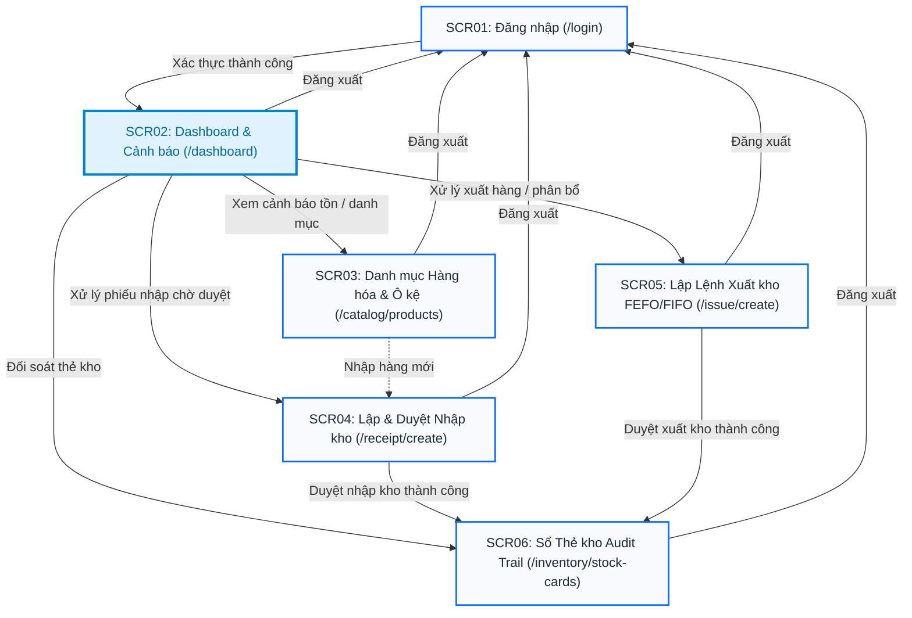

# ĐẶC TẢ MÀN HÌNH GIAO DIỆN & LUỒNG ĐIỀU HƯỚNG (SCREEN SPECIFICATIONS)

**Mã nguồn Templates Spring Boot Modular:**
- Landing Page: [`landing.html`](../../source/src/main/resources/templates/landing.html)
- Khung Dashboard Shell: [`index.html`](../../source/src/main/resources/templates/index.html)
- Xác thực & Đăng nhập: [`templates/auth/login.html`](../../source/src/main/resources/templates/auth/login.html)
- Danh mục Hàng hóa (SKU): [`templates/catalog/products.html`](../../source/src/main/resources/templates/catalog/products.html)
- Sơ đồ Ô kệ 3M: [`templates/catalog/locations.html`](../../source/src/main/resources/templates/catalog/locations.html)
- Lập Phiếu Nhập PO: [`templates/receipt/create.html`](../../source/src/main/resources/templates/receipt/create.html)
- Phê Duyệt Nhập Kho: [`templates/receipt/approve.html`](../../source/src/main/resources/templates/receipt/approve.html)
- Lập Lệnh Xuất FEFO/FIFO: [`templates/issue/create.html`](../../source/src/main/resources/templates/issue/create.html)
- Hướng dẫn Lấy hàng Pick List: [`templates/issue/pick.html`](../../source/src/main/resources/templates/issue/pick.html)
- Sổ Thẻ Kho Điện Tử: [`templates/inventory/stock_card.html`](../../source/src/main/resources/templates/inventory/stock_card.html)
- Bảng Cảnh Báo Tồn Kho: [`templates/inventory/alerts.html`](../../source/src/main/resources/templates/inventory/alerts.html)
**Tài nguyên tĩnh (Assets):** [`source/src/main/resources/static/assets/`](../../source/src/main/resources/static/assets/)  
**Hệ thống Controllers phân tầng:**  
- `WebViewController.java`: Điều hướng Landing Page & Dashboard App  
- `AuthController.java`: Điều hướng `/auth/login` & xác thực  
- `CatalogController.java`: Điều hướng `/catalog/products`, `/catalog/locations`  
- `ReceiptController.java`: Điều hướng `/receipt/create`, `/receipt/approve`  
- `IssueController.java`: Điều hướng `/issue/create`, `/issue/pick`  
- `InventoryController.java`: Điều hướng `/inventory/stock-card`, `/inventory/alerts`  

---
## 1. ĐẶC TẢ CHI TIẾT 6 MÀN HÌNH CỐT LÕI (CORE SCREENS SPECIFICATION)

### 1.1. SCR01 - Màn hình Đăng nhập (Authentication)

| Thuộc tính | Chi tiết đặc tả |
| :--- | :--- |
| **Mã màn hình** | `SCR01` |
| **Tên màn hình** | Đăng nhập Hệ thống SmartWMS |
| **Tác nhân sử dụng** | Tất cả người dùng (Public / Khách vãng lai, Nhân viên kho, Quản lý kho, Quản trị viên) |
| **Yêu cầu chức năng** | `FR-AUTH.01` (Xác thực người dùng), `NFR-SEC-01` (Mã hóa mật khẩu BCrypt), `BR-SEC-03` |
| **Mục đích giao diện** | Xác minh danh tính người dùng qua tài khoản và mật khẩu, khởi tạo phiên làm việc có phân quyền (RBAC). |

#### Bảng Tương tác UI và Luồng chuyển trang (Navigation Flow):
| Mã phần tử | Loại UI | Nhãn / Tên | Hành vi tương tác | Luồng xử lý & Màn hình đích (Next Route) |
| :---: | :--- | :--- | :--- | :--- |
| `INP_01` | Text Input | "Tên đăng nhập / Email" | Người dùng nhập ký danh | Lưu giá trị `username` vào `LoginRequestDTO` |
| `INP_02` | Password Input | "Mật khẩu" | Người dùng nhập mật khẩu | Lưu giá trị `password` (che ký tự bằng dấu chấm) |
| `SEL_03` | Dropdown Select | "Giả lập vai trò (Demo Switcher)" | Chọn vai trò chạy thử | Thiết lập Role giả lập (`ROLE_STAFF`, `ROLE_MANAGER`, `ROLE_ADMIN`) |
| `CHK_04` | Checkbox | "Ghi nhớ đăng nhập" | Click chọn/bỏ chọn | Lưu trữ token ghi nhớ phiên làm việc trên trình duyệt |
| `BTN_05` | Primary Button | "Đăng nhập hệ thống" | Click | Validate rỗng $\rightarrow$ Gửi `POST /api/v1/auth/login`. Nếu đúng: Lưu session và điều hướng sang `SCR02` (`/dashboard`). Nếu sai: Hiển thị Toast lỗi đỏ |

---

### 1.2. SCR02 - Dashboard Tổng quan & Cảnh báo Tồn kho Thời gian thực

| Thuộc tính | Chi tiết đặc tả |
| :--- | :--- |
| **Mã màn hình** | `SCR02` |
| **Tên màn hình** | Dashboard Tổng quan & Cảnh báo Tồn kho |
| **Tác nhân sử dụng** | `ROLE_STAFF` (Thủ kho), `ROLE_MANAGER` (Quản lý kho) |
| **Yêu cầu chức năng** | `FR-INV.02` (Cảnh báo tồn tối thiểu), `FR-INV.03` (Cảnh báo cận hạn), `UC07` |
| **Mục đích giao diện** | Cung cấp cái nhìn toàn cảnh về khối lượng hàng hóa, các phiếu đang xử lý và kích hoạt phản ứng khẩn cấp với hàng cận hạn/thiếu hụt. |

#### Bảng Tương tác UI và Luồng chuyển trang (Navigation Flow):
| Mã phần tử | Loại UI | Nhãn / Tên | Hành vi tương tác | Luồng xử lý & Màn hình đích (Next Route) |
| :---: | :--- | :--- | :--- | :--- |
| `CARD_01` | KPI Stat Card | "Tổng mã hàng (SKU)" | Xem số liệu tổng hợp | Hiển thị tổng số 128 mã sản phẩm đang quản lý |
| `CARD_02` | KPI Stat Card | "Phiếu Nhập Chờ Duyệt" | Click | Lọc nhanh và chuyển sang `SCR04` (danh sách phiếu chờ duyệt) |
| `CARD_03` | KPI Stat Card | "Phiếu Xuất Đang Giữ Tồn" | Click | Chuyển sang `SCR05` xem các lệnh xuất đang tạm giữ Reserved |
| `CARD_04` | KPI Stat Card | "Cảnh Báo Nguy Cấp" | Click cuộn trang | Tự động cuộn xuống 2 bảng cảnh báo tồn bên dưới |
| `TBL_05` | Data Table | "Cảnh Báo Tồn Dưới Định Mức" | Tra cứu danh sách | Hiển thị SKU có `availableQty <= minStockAlert`. Badge đỏ "NGUY CẤP" |
| `TBL_06` | Data Table | "Cảnh Báo Lô Hàng Cận Hạn (FEFO)" | Tra cứu lô hàng | Hiển thị lô hàng có ngày hết hạn `<= 30 ngày`. Gợi ý: "Ưu tiên xuất FEFO" |

---

### 1.3. SCR03 - Quản lý Danh mục Hàng hóa (SKU) & Sơ đồ Vị trí Ô kệ

| Thuộc tính | Chi tiết đặc tả |
| :--- | :--- |
| **Mã màn hình** | `SCR03` |
| **Tên màn hình** | Danh mục Hàng hóa & Quản lý Ô kệ Kho |
| **Tác nhân sử dụng** | `ROLE_STAFF`, `ROLE_MANAGER` |
| **Yêu cầu chức năng** | `FR-CAT.01` (Quản lý SKU), `FR-CAT.02` (Quản lý Ô kệ), `UC01` |
| **Mục đích giao diện** | Tra cứu, lọc danh mục SKU, xem dung tích/tải trọng của từng ô kệ theo phân khu (RAW, FG, DOCK...). |

#### Bảng Tương tác UI và Luồng chuyển trang (Navigation Flow):
| Mã phần tử | Loại UI | Nhãn / Tên | Hành vi tương tác | Luồng xử lý & Màn hình đích (Next Route) |
| :---: | :--- | :--- | :--- | :--- |
| `TAB_01` | Tab Button | "Danh mục Mặt hàng (SKU)" | Click chuyển tab | Hiển thị bảng tra cứu hàng hóa, khối lượng, thời hạn bảo quản |
| `TAB_02` | Tab Button | "Vị trí Ô kệ (Locations)" | Click chuyển tab | Hiển thị danh sách ô kệ kèm thanh tiến độ tải trọng (Progress bar %) |
| `INP_03` | Search Input | "Tìm theo SKU, tên sản phẩm..." | Nhập từ khóa | Lọc bảng dữ liệu ngay trên client |
| `BTN_04` | Primary Button | "+ Thêm mới" | Click | Mở Modal tạo mới: Nhập `skuCode`, `name`, `categoryId`, `uom`, `minStockAlert` $\rightarrow$ Gọi `POST /api/v1/catalog/products` |

---

### 1.4. SCR04 - Tiếp nhận & Lập Phiếu Nhập kho PO / Phê duyệt Nhập

| Thuộc tính | Chi tiết đặc tả |
| :--- | :--- |
| **Mã màn hình** | `SCR04` |
| **Tên màn hình** | Quản lý Nhập kho & Phê duyệt Nhập |
| **Tác nhân sử dụng** | `ROLE_STAFF` (Người lập phiếu - Maker), `ROLE_MANAGER` (Người duyệt phiếu - Checker) |
| **Yêu cầu chức năng** | `FR-INB.01` (Lập phiếu nhập PO), `FR-INB.02` (Duyệt phiếu nhập), `UC02`, `UC03` |
| **Mục đích giao diện** | Cho phép thủ kho đối soát đơn hàng PO, kiểm đếm số lượng, chọn ô kệ tiếp nhận; đồng thời hỗ trợ quản lý thẩm định phê duyệt theo quy tắc Maker-Checker (`BR-SEC-03`). |

#### Bảng Tương tác UI và Luồng chuyển trang (Navigation Flow):
| Mã phần tử | Loại UI | Nhãn / Tên | Hành vi tương tác | Luồng xử lý & Màn hình đích (Next Route) |
| :---: | :--- | :--- | :--- | :--- |
| `INP_01` | Text Input | "Số Đơn Hàng PO" | Nhập mã PO | Bắt buộc (`@NotBlank`), đối soát với hợp đồng nhà cung cấp |
| `INP_02` | Text Input | "Nhà Cung Cấp" | Nhập tên NCC | Bắt buộc |
| `TBL_03` | Dynamic Table | "Chi Tiết Mặt Hàng Kiểm Nhận" | Nhập liệu từng dòng | Nhập SKU, Số lô, Ngày SX, Hạn dùng, SL thực nhận, Ô kệ tiếp nhận |
| `VAL_04` | Validation Banner | Kiểm tra ràng buộc | Tự động kiểm tra | Nếu `actualQty > plannedQty` báo lỗi `BR-INB-01`; nếu `expiryDate <= today` báo lỗi `BR-LOT-01` |
| `BTN_05` | Primary Button | "Gửi duyệt phiếu nhập" | Click submit | Validate $\rightarrow$ Gọi `POST /api/v1/receipts` $\rightarrow$ Tạo phiếu `RN-YYYYMMDD-XXXX` trạng thái `PENDING_APPROVAL` |
| `CARD_06` | Approval Panel | "Thẩm Định & Duyệt (UC03)" | Quản lý kiểm duyệt | Kiểm tra quy tắc `currentUserId != maker_id` (`BR-SEC-03`). Nhập ý kiến `reviewNote` |
| `BTN_07` | Success Button | "Chấp Thuận Nhập Kho" | Click | Gọi `POST /api/v1/receipts/{id}/approve` $\rightarrow$ Tăng tồn kho thực tế, tăng tải trọng ô kệ và ghi sổ Thẻ kho |
| `BTN_08` | Danger Button | "Từ Chối Phiếu" | Click | Chuyển trạng thái phiếu sang `REJECTED`, lưu lý do từ chối |

---

### 1.5. SCR05 - Lập Lệnh Xuất kho (Gợi ý Phân bổ FEFO/FIFO) & Phê duyệt Xuất

| Thuộc tính | Chi tiết đặc tả |
| :--- | :--- |
| **Mã màn hình** | `SCR05` |
| **Tên màn hình** | Lập Lệnh Xuất kho & Gợi ý Phân bổ Lô |
| **Tác nhân sử dụng** | `ROLE_STAFF` (Lập lệnh), `ROLE_MANAGER` (Duyệt xuất) |
| **Yêu cầu chức năng** | `FR-OUT.01` (Lập lệnh xuất), `FR-OUT.02` (Phân bổ FEFO/FIFO), `FR-OUT.03` (Duyệt xuất), `UC04`, `UC05` |
| **Mục đích giao diện** | Tự động hóa phân bổ lô hàng lấy hàng tối ưu theo hạn dùng hoặc ngày nhập, tránh xuất nhầm lô hết date và ngăn chặn xuất âm (`BR-OUT-01`). |

#### Bảng Tương tác UI và Luồng chuyển trang (Navigation Flow):
| Mã phần tử | Loại UI | Nhãn / Tên | Hành vi tương tác | Luồng xử lý & Màn hình đích (Next Route) |
| :---: | :--- | :--- | :--- | :--- |
| `RAD_01` | Radio Option | "FEFO (Hạn dùng trước)" | Click chọn | Chọn chiến lược ưu tiên lô cận hạn nhất lấy trước (Khuyên dùng) |
| `RAD_02` | Radio Option | "FIFO (Nhập trước)" | Click chọn | Chọn chiến lược ưu tiên lô nhập kho lâu nhất lấy trước |
| `SEL_03` | Dropdown Select | "Chọn Mặt Hàng Cần Xuất" | Chọn SKU | Hiển thị tổng tồn khả dụng thực tế (`Available = OnHand - Reserved`) |
| `INP_04` | Number Input | "Số Lượng Yêu Cầu Xuất" | Nhập số lượng | Kiểm tra nếu `requestedQty > availableQty` $\rightarrow$ Ném lỗi `BR-OUT-01` |
| `BTN_05` | Warning Button | "⚡ Gợi Ý Phân Bổ Bốc Hàng" | Click | Kích hoạt thuật toán phân bổ $\rightarrow$ Hiển thị bảng đề xuất Pick List (Số lô, Hạn dùng, Tọa độ ô kệ, SL bốc tại ô) |
| `TBL_06` | Result Table | "Pick List Proposal" | Xem danh sách bốc hàng | Bảng hiển thị thứ tự các ô kệ cần đến lấy hàng kèm số lượng cụ thể |
| `BTN_07` | Primary Button | "Tạo Lệnh Xuất (Khóa Giữ Chỗ)" | Click | Gửi `POST /api/v1/issues` $\rightarrow$ Tạo phiếu xuất `IN-...`, tăng tồn `reserved_qty` để bảo vệ hàng |
| `BTN_08` | Action Button | "Phê duyệt Xuất & In Picklist" | Click (Manager) | Gửi `POST /api/v1/issues/{id}/approve` $\rightarrow$ Trừ tồn thực tế, giải phóng giữ chỗ, ghi Thẻ kho âm |

---

### 1.6. SCR06 - Sổ Nhật ký Thẻ kho & Lịch sử Biến động Kiểm toán

| Thuộc tính | Chi tiết đặc tả |
| :--- | :--- |
| **Mã màn hình** | `SCR06` |
| **Tên màn hình** | Sổ Thẻ kho & Lịch sử Biến động Kiểm toán |
| **Tác nhân sử dụng** | `ROLE_STAFF`, `ROLE_MANAGER` |
| **Yêu cầu chức năng** | `FR-INV.01` (Truy vấn Thẻ kho), `UC06`, `NFR-AUD-01` (Tính toàn vẹn kiểm toán) |
| **Mục đích giao diện** | Tra cứu lịch sử biến động vào/ra kho theo từng chứng từ, phục vụ công tác đối soát, kiểm kê và kiểm toán kho hàng. |

#### Bảng Tương tác UI và Luồng chuyển trang (Navigation Flow):
| Mã phần tử | Loại UI | Nhãn / Tên | Hành vi tương tác | Luồng xử lý & Màn hình đích (Next Route) |
| :---: | :--- | :--- | :--- | :--- |
| `SEL_01` | Dropdown Select | "Mặt Hàng Cần Tra Cứu" | Chọn SKU | Lọc dữ liệu thẻ kho của một sản phẩm cụ thể |
| `DAT_02` | Date Input | "Từ Ngày" / "Đến Ngày" | Chọn khoảng thời gian | Giới hạn chu kỳ đối soát kiểm toán |
| `BTN_03` | Primary Button | "Lọc dữ liệu" | Click | Gọi `GET /api/v1/inventory/stock-cards` $\rightarrow$ Tải lại bảng nhật ký |
| `ROW_04` | Summary Cards | "Tồn đầu kỳ - Tổng nhập - Tổng xuất - Tồn cuối kỳ" | Xem tổng hợp | Thống kê số lượng theo công thức cân bằng tồn kho |
| `TBL_05` | Audit Table | "Bảng Nhật Ký Biến Động" | Tra cứu chi tiết | Cột: Thời gian, Loại biến động (`NHAP_PO`/`XUAT_KHO`), Chứng từ gốc, Số lô, Ô kệ, Tồn trước, Biến động (+/-), Tồn sau, Người thực hiện |
| `BTN_06` | Secondary Button | "Xuất Excel" | Click | Xuất toàn bộ dữ liệu thẻ kho ra tệp tin bảng tính phục vụ báo cáo |

---

## 2. SƠ ĐỒ LUỒNG ĐIỀU HƯỚNG TỔNG THỂ (SCREEN NAVIGATION FLOW DIAGRAM)

---