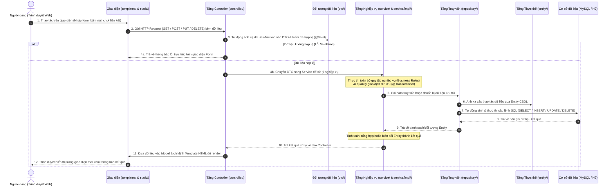

# HƯỚNG DẪN KIẾN TRÚC MÃ NGUỒN SPRING BOOT (SOURCE CODE ARCHITECTURE)
**Học phần:** Phân tích và Thiết kế Yêu cầu (Mã môn: 502050 - ĐH Tôn Đức Thắng)  
**Đề tài:** Hệ thống Quản lý Kho hàng (Warehouse Management System - WMS)  
**Nền tảng:** Java 17 | Spring Boot 3.3.4 | Spring Data JPA | Thymeleaf | Bootstrap 5  

Tài liệu này là **kim chỉ nam kỹ thuật** cho 4 thành viên trong nhóm khi tham gia phát triển mã nguồn ở Sprint 3 và Sprint 5. Đảm bảo mọi thành viên hiểu rõ cấu trúc thư mục, luồng tương tác giữa các file và quy chuẩn bắt buộc khi tạo bất kỳ file mới nào.

---

## I. TỔNG QUAN FILE QUẢN LÝ DỰ ÁN (`pom.xml`)

File `pom.xml` (Project Object Model) nằm ở thư mục gốc của `source/`, đóng vai trò là "bản thiết kế kỹ thuật" quản lý vòng đời ứng dụng, phiên bản Java và toàn bộ các thư viện bên thứ ba (Dependencies).

### Bảng chi tiết các Dependency cốt lõi được cấu hình:

| Dependency Artifact | Phiên bản | Mục đích & Vai trò trong dự án | Lý do lựa chọn cho đồ án BA |
| :--- | :---: | :--- | :--- |
| **`spring-boot-starter-web`** | 3.3.4 | Cung cấp toàn bộ hạ tầng Spring MVC, RESTful API và **Embedded Apache Tomcat** tích hợp sẵn. | Không cần cài đặt máy chủ Tomcat ngoài. Khởi động ứng dụng ngay trên cổng 8080. |
| **`spring-boot-starter-thymeleaf`** | 3.3.4 | Template Engine xử lý hiển thị giao diện Web HTML động từ dữ liệu server truyền sang. | Cú pháp tự nhiên (`th:text`, `th:each`), tích hợp mượt mà với Spring Model, dễ dựng giao diện Web. |
| **`spring-boot-starter-data-jpa`** | 3.3.4 | Framework ORM (Hibernate) ánh xạ các bảng CSDL quan hệ thành các Java Class (`@Entity`). | Tự động hóa 100% câu lệnh CRUD cơ bản thông qua `JpaRepository`, không phải viết SQL thủ công. |
| **`spring-boot-starter-validation`** | 3.3.4 | Bộ thư viện kiểm tra tính hợp lệ của dữ liệu đầu vào (`@NotNull`, `@Min`, `@Size`, `@NotBlank`). | Hiện thực hóa trực tiếp các ràng buộc nghiệp vụ (Business Rules) từ tài liệu SRS vào code. |
| **`mysql-connector-j`** | Runtime | Driver JDBC giao tiếp chính thức với hệ quản trị CSDL MySQL. | Phục vụ kết nối cơ sở dữ liệu thật khi triển khai. |
| **`h2`** | Runtime | CSDL In-memory siêu nhẹ chạy trực tiếp trong RAM. | **Phương án dự phòng an toàn:** Giúp phần mềm chạy demo ngay lập tức trên máy chấm thi mà không cần cài đặt MySQL. |
| **`spring-boot-starter-test`** | Test | Bộ thư viện kiểm thử tự động gồm JUnit 5, Mockito, AssertJ. | Thực hiện viết Unit Test và Integration Test kiểm chứng các ca kiểm thử ở Sprint 5. |

---

## II. CẤU TRÚC THƯ MỤC `src/` & Ý NGHĨA PHÂN CHIA

Toàn bộ mã nguồn tuân thủ nghiêm ngặt **Kiến trúc phân lớp chuẩn (Layered Architecture)** để đảm bảo nguyên lý **Đơn trách nhiệm (Single Responsibility Principle)** và **Phân tách mối quan tâm (Separation of Concerns)**.

```text
source/src/
├── main/
│   ├── java/com/wms/                          # MÃ NGUỒN JAVA CHÍNH
│   │   ├── WmsApplication.java                # File khởi chạy chính (@SpringBootApplication)
│   │   ├── config/                            # Tầng Cấu hình hệ thống
│   │   ├── controller/                        # Tầng Điều hướng & Xử lý Web Request (Presentation)
│   │   ├── dto/                               # Tầng Dữ liệu truyền tải (Data Transfer Objects)
│   │   ├── entity/                            # Tầng Thực thể CSDL (Domain Entities / Models)
│   │   ├── repository/                        # Tầng Truy vấn Dữ liệu (Data Access Layer - DAO)
│   │   ├── service/                           # Tầng Xử lý Nghiệp vụ lõi (Business Logic Layer)
│   │   │   └── impl/                          # Các lớp hiện thực chi tiết của Service
│   │   └── util/                              # Tầng Tiện ích, Hằng số, Enum trạng thái
│   └── resources/                             # TÀI NGUYÊN HỆ THỐNG
│       ├── application.properties             # Cấu hình CSDL, Server Port, Hibernate
│       ├── static/                            # Tài nguyên tĩnh phía Client (CSS, JS, Icons, Images)
│       └── templates/                         # Giao diện Web động Thymeleaf (.html)
└── test/java/com/wms/                         # MÃ NGUỒN KIỂM THỬ (JUNIT 5 TESTS)
```

### Chi tiết chức năng từng thư mục:

### 1. Thư mục `src/main/java/com/wms/`
- **`config/` (Configuration Layer):**
  - *Chức năng:* Chứa các class cấu hình hệ thống bằng Java Config (thay thế file XML cũ).
  - *Ví dụ:* Cấu hình định dạng ngày tháng (`WebMvcConfig`), phân quyền bảo mật, cấu hình phân trang.
- **`controller/` (Presentation Layer - Tầng Giao diện/Điều hướng):**
  - *Chức năng:* Là cửa ngõ đón nhận mọi HTTP Request từ trình duyệt người dùng gửi lên. Nhiệm vụ duy nhất là: kiểm tra tính hợp lệ dữ liệu (Validation), gọi sang tầng Service xử lý, nhận kết quả và chọn View HTML để hiển thị hoặc trả về JSON.
  - *Quy tắc:* **Tuyệt đối không viết câu lệnh SQL hoặc tính toán logic nghiệp vụ tại đây.**
- **`dto/` (Data Transfer Object Layer):**
  - *Chức năng:* Chứa các class chỉ gồm thuộc tính và getter/setter, dùng để đóng gói dữ liệu truyền từ Form Web lên Controller hoặc từ Service ra ngoài.
  - *Ví dụ:* `IssueNoteRequestDTO` (chứa danh sách mã hàng, số lượng xuất từ form), `StockAlertResponseDTO`.
  - *Lợi ích:* Ngăn chặn việc lộ cấu trúc Entity CSDL ra ngoài giao diện và hỗ trợ validation form dễ dàng bằng chú thích `@Valid`.
- **`entity/` (Data Model Layer):**
  - *Chức năng:* Ánh xạ 1-1 với các bảng trong cơ sở dữ liệu quan hệ (được thiết kế ở Chương 3). Mỗi class đại diện cho 1 bảng, mỗi thuộc tính đại diện cho 1 cột.
  - *Annotation bắt buộc:* `@Entity`, `@Table(name = "...")`, `@Id`, `@Column`, `@ManyToOne`, `@OneToMany`.
- **`repository/` (Data Access Layer - Tương đương DAO):**
  - *Chức năng:* Tầng giao tiếp trực tiếp với cơ sở dữ liệu. Chỉ khai báo Interface kế thừa `JpaRepository<Entity, ID>`.
  - *Ví dụ:* `ProductRepository`, `StockBatchRepository`. Spring Boot sẽ tự sinh code truy vấn CRUD mà lập trình viên không cần viết code implementation.
- **`service/` & `service/impl/` (Business Logic Layer - Trọng tâm đồ án BA):**
  - *Chức năng:* Chứa **100% logic nghiệp vụ** của hệ thống WMS (thuật toán xuất hàng FIFO/FEFO, công thức tính tồn kho khả dụng `BR01`, kiểm tra chặn xuất âm `BR03`, thuật toán quét cảnh báo tồn kho tối thiểu `BR04`).
  - *Cấu trúc:* Tách biệt giữa Interface (`ProductService`) và Implementation (`ProductServiceImpl`).
  - *Annotation bắt buộc:* `@Service`, `@Transactional` (đảm bảo giao dịch toàn vẹn ACID, tự động rollback nếu xảy ra lỗi giữa chừng).
- **`util/` (Utility Layer):**
  - *Chức năng:* Chứa các hằng số dùng chung (`AppConstants`), các kiểu dữ liệu liệt kê trạng thái (`OrderStatus`, `BatchStatus`), các hàm tiện ích tĩnh (định dạng tiền tệ, xử lý ngày tháng).

---

### 2. Thư mục `src/main/resources/`
- **`application.properties`:** Chứa mọi thông số môi trường của ứng dụng: cổng chạy (`server.port=8080`), cấu hình kết nối CSDL (URL, username, password), cấu hình cache Thymeleaf.
- **`static/`:** Chứa các tài nguyên tĩnh không bị thay đổi bởi server, được trình duyệt tải trực tiếp:
  - `css/`: File định dạng giao diện (`custom.css`, thư viện Bootstrap 5).
  - `js/`: Mã JavaScript hỗ trợ người dùng ở Client (thông báo Toast, AJAX Fetch API).
  - `images/`: Logo trường TDTU, biểu tượng kho hàng, avatar người dùng.
- **`templates/`:** Chứa các trang giao diện Web được render bởi Thymeleaf (`.html`).
  - *Cấu trúc đề xuất:*
    - `layout/`: Chứa khung chung (header, sidebar, footer).
    - `dashboard/`: Trang chủ tổng quan & biểu đồ cảnh báo.
    - `receipt/`: Các trang nhập kho (danh sách, tạo phiếu nhập theo lô).
    - `issue/`: Các trang xuất kho (gợi ý lô theo FIFO, lập phiếu xuất).
    - `inventory/`: Các trang tra cứu tồn kho, thẻ kho.

---

### 3. Thư mục `src/test/java/com/wms/`
- Chứa các class kiểm thử tự động bằng JUnit 5.
- Ánh xạ trực tiếp từ các mã ca kiểm thử ở Chương 6 (ví dụ: test case `TC-FR03.03-N` kiểm tra hàm xuất kho phải ném ngoại lệ khi số lượng xuất vượt quá tồn kho khả dụng).

---

## III. LUỒNG ĐIỀU PHỐI TỔNG QUÁT MỘT HOẠT ĐỘNG TRÊN WEB (SPRING BOOT REQUEST LIFECYCLE)

Mọi thao tác của người dùng trên giao diện Web (ví dụ: bấm nút gửi Form nhập/xuất kho, tìm kiếm hàng hóa, xem báo cáo tồn kho) đều được điều phối tuần tự qua các tầng kiến trúc theo **mô hình MVC + Service-Repository Layer** tổng quát dưới đây:



### Tóm tắt vai trò điều phối của từng tầng trong một hoạt động:
1. **Trình duyệt (`templates/`, `static/`):** Nơi người dùng tương tác, nhập dữ liệu vào Form và gửi yêu cầu (HTTP Request) lên Server.
2. **`controller/`:** Đón nhận HTTP Request đầu tiên, làm nhiệm vụ "người gác cổng" (chỉ nhận yêu cầu, kiểm tra tính hợp lệ cú pháp, không làm nghiệp vụ) rồi chuyển việc cho Service.
3. **`dto/`:** Đóng vai trò chiếc "hộp chứa" dữ liệu gửi lên từ form hoặc dữ liệu xuất ra ngoài, giúp bảo vệ các Entity nội bộ.
4. **`service/` & `service/impl/`:** Bộ não trung tâm của ứng dụng. Chịu trách nhiệm toàn bộ việc tính toán logic nghiệp vụ (kiểm tra tồn kho, áp dụng quy tắc xuất nhập, tính hạn sử dụng...) và bảo toàn tính toàn vẹn dữ liệu (`@Transactional`).
5. **`repository/`:** Cầu nối dữ liệu. Nhận chỉ thị từ Service để đọc/ghi vào CSDL thông qua các hàm có sẵn của JPA.
6. **`entity/`:** Đại diện cấu trúc bảng trong CSDL, giúp Java tương tác với các dòng dữ liệu dưới dạng các Object thuần túy (OOP).
7. **`templates/`:** Nhận dữ liệu kết quả từ Controller để lấp đầy vào các thẻ Thymeleaf (`th:text`, `th:each`) tạo thành trang HTML hoàn chỉnh trả về người dùng.

---

## IV. QUY CHUẨN KHI TẠO FILE MỚI TRONG TỪNG FOLDER (DEVELOPER CHEATSHEET)

Khi một thành viên được giao task code trong Sprint 5, mở bất kỳ thư mục nào để tạo file mới **bắt buộc phải nắm rõ chức năng chung và tuân theo bảng quy chuẩn sau**:

| Thư mục (Package) | Quy ước đặt tên file | Annotation bắt buộc | Trách nhiệm bắt buộc của file | Những điều TUYỆT ĐỐI CẤM |
| :--- | :--- | :--- | :--- | :--- |
| **`entity/`** | Danh từ số ít, PascalCase.<br>*Ví dụ:* `Product.java`, `StockBatch.java` | `@Entity`<br>`@Table(name="tên_bảng")` | Đại diện cho cấu trúc 1 bảng trong CSDL. Chứa thuộc tính, getter/setter, khóa chính `@Id`. | **CẤM** viết các hàm tính toán nghiệp vụ phức tạp trong Entity. |
| **`repository/`** | `<TênEntity>Repository.java`.<br>*Ví dụ:* `StockBatchRepository.java` | `@Repository` (kế thừa `JpaRepository`) | Định nghĩa các hàm truy vấn CSDL. Sử dụng quy tắc đặt tên hàm của JPA hoặc `@Query`. | **CẤM** đưa logic nghiệp vụ (thuật toán FIFO, trừ kho) vào Repository. |
| **`service/`** | Interface: `<TênChứcNăng>Service.java`.<br>Class: `<TênChứcNăng>ServiceImpl.java` | `@Service`<br>`@Transactional` | Xử lý toàn bộ logic tính toán, kiểm tra quy tắc BR, điều phối lưu dữ liệu giữa các Repository. | **CẤM** truy cập trực tiếp `HttpServletRequest`, `Model` hay các đối tượng thuộc tầng View. |
| **`controller/`** | `<TênChứcNăng>Controller.java`.<br>*Ví dụ:* `IssueController.java` | `@Controller` hoặc `@RestController`<br>`@RequestMapping("/...")` | Hứng request, kiểm tra `@Valid`, gọi Service, chuyển tiếp dữ liệu ra View qua `Model`. | **CẤM** gọi trực tiếp Repository mà không thông qua Service; **CẤM** viết code SQL. |
| **`dto/`** | `<HànhĐộng>RequestDTO.java` hoặc `<ĐốiTượng>ResponseDTO.java` | `@NotNull`, `@Min`, `@NotBlank` (Validation annotations) | Đóng gói dữ liệu đầu vào từ Form hoặc dữ liệu trả về cho View/API. | **CẤM** gắn annotation `@Entity` hay `@Table` vào DTO. |
| **`templates/`** | Tên chức năng viết thường, dùng dấu gạch dưới hoặc thư mục con.<br>*Ví dụ:* `issue/create.html` | Thẻ Thymeleaf: `th:text`, `th:field`, `th:each`, `th:if` | Hiển thị dữ liệu trực quan cho người dùng, chứa form nhập liệu gửi lên Controller. | **CẤM** hardcode dữ liệu mẫu (dữ liệu phải được truyền động từ Controller qua `model.addAttribute`). |

